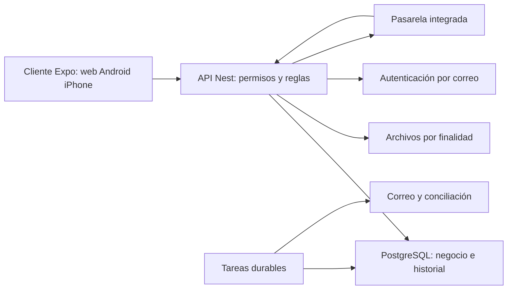
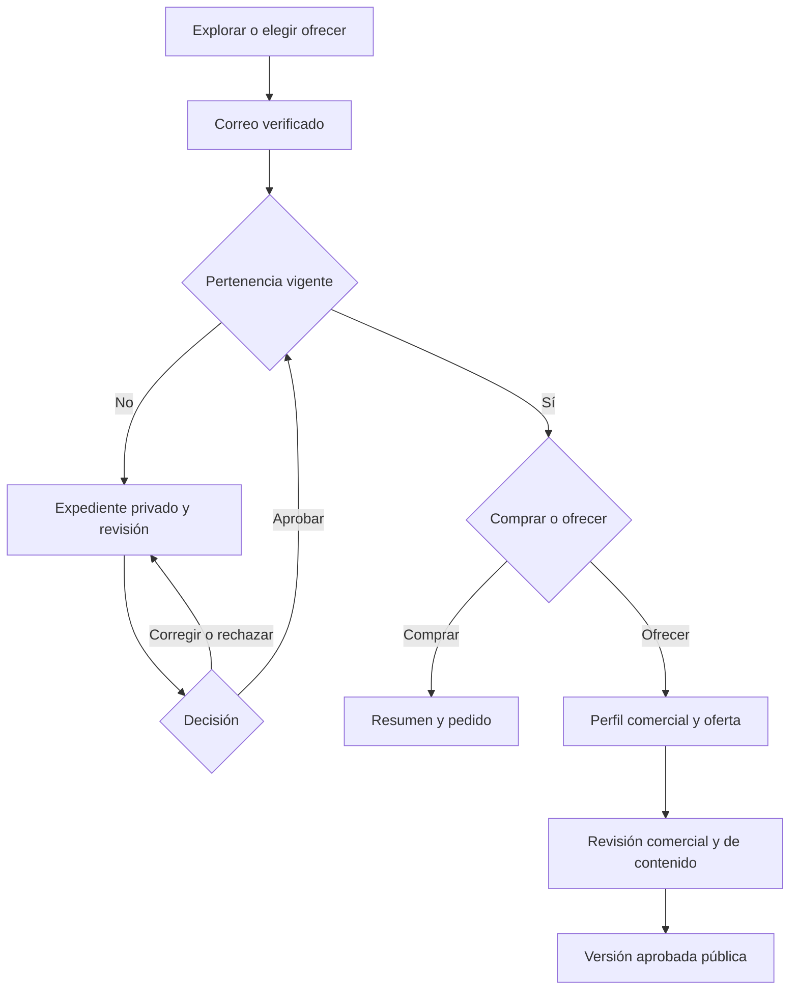
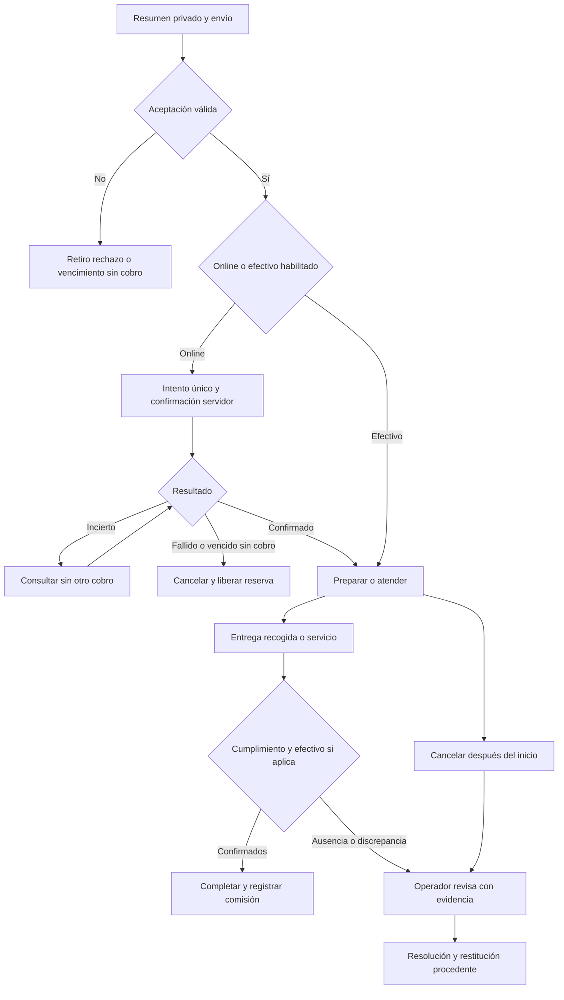
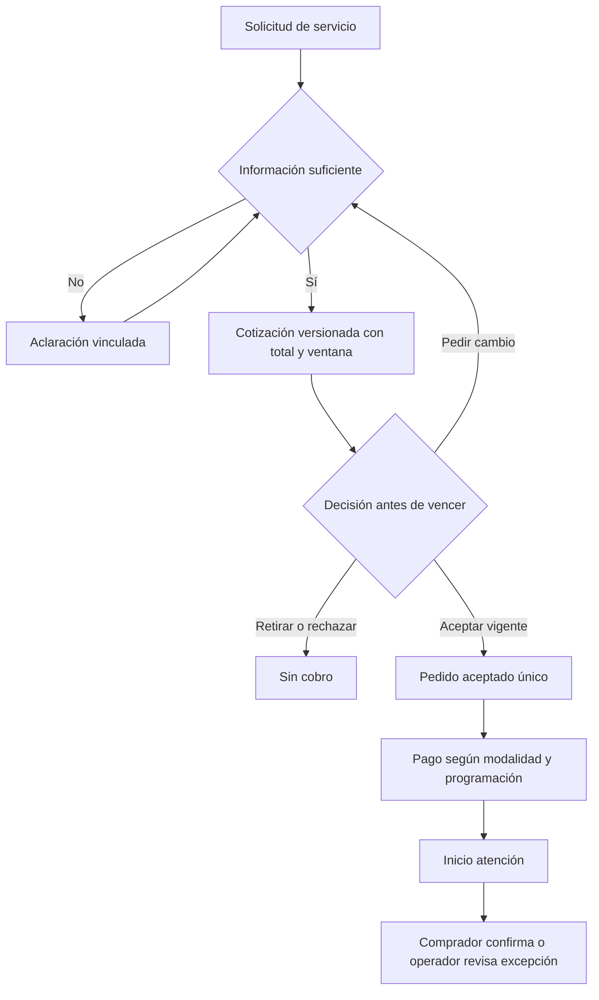
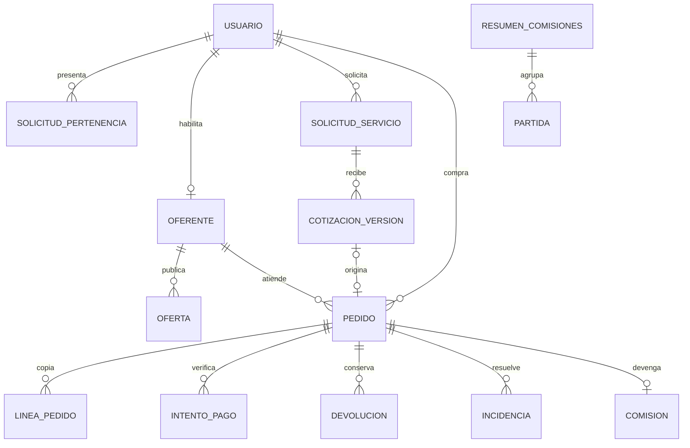

# Marleva: alcance y diseño de MVP1

Versión 1.22. Fecha: 13 de octubre de 2026. Alcance y diseño inicial cerrados documentalmente en MAR-CHAT-002; preparación del arranque base/M1 documentada en MAR-CHAT-003. Alcance C25 y referencia de pagos C26 confirmados, revisables según registro. Estado actual004: desarrollo local autorizado y parcialmente ejecutado; revisión documental16.6 antes de continuar. Sin publicación, contratación, cuentas externas ni operación real. Evidencia parcial en03; M1 incompleta.

Reglas: [00_GUIA_PRINCIPAL_MARLEVA.md](00_GUIA_PRINCIPAL_MARLEVA.md). Aprobaciones: [01_ESTADO_Y_DECISIONES_MARLEVA.md](01_ESTADO_Y_DECISIONES_MARLEVA.md). Fuentes y límites: [03_REFERENTES_Y_EVIDENCIA_MARLEVA.md](03_REFERENTES_Y_EVIDENCIA_MARLEVA.md). Las decisiones C01–C26 prevalecen; los detalles rutinarios siguientes son elecciones documentales del asistente dentro del encargo, no resultados probados.

## 1. Objetivo, comunidad y límite

MVP1 debe permitir descubrir una oferta vecinal, comprar un producto o contratar un servicio cotizado, pagar online o en efectivo, recibirlo y resolver fallos. Debe registrar ingresos propios, costos, repetición y trabajo operativo. No equivale a rentabilidad demostrada.

Solo residentes actuales de Gran Santa Fe I/II, Norte I/II/III, Cerradas de Gran Santa Fe y Paraíso Santa Fe compran/ofrecen; incluye inquilinos y familiares, no propietarios no residentes. Negocio externo del residente es permitido. Pertenencia, cobertura y punto de atención son datos distintos. Cualquiera explora catálogo público; domicilio residencial y documentos de pertenencia no son públicos. Demografía y límites geográficos originales siguen pausados/no validados.

| Módulo | Incluye en línea base funcional C25 | Salida comprobable futura |
|---|---|---|
| M1 Acceso y cuenta | Código por correo, sesión, salida, cambio de correo y límite de recuperación C15 | Retomar acción propia tras autenticar; sesión revocada no opera |
| M2 Comunidad y oferentes | Solicitud privada, corrección/revisión, perfil comercial, modalidades/cobertura | No aprobado no transacciona; convertirse en oferente reutiliza pertenencia |
| M3 Catálogo | Ofertas versionadas/revisadas, fotos, disponibilidad, búsqueda y filtros | Solo versión elegible pública; precios y modalidades claros |
| M4 Compra directa | Pedido de productos a precio fijo, un oferente, resumen, aceptación/rechazo | Copia de lo comprado; sin sustitución o aceptación parcial; un envío no duplica pedido |
| M5 Cotización | Solicitud estructurada, aclaraciones vinculadas, cotización versionada y aceptación | Una versión vigente; una aceptación crea un pedido de servicio |
| M6 Dinero | Intentos online, efectivo, devoluciones, comisiones, corte y conciliación | Pago, atención e ingreso propio separados; reintento no duplica dinero |
| M7 Atención | Entrega/recogida del oferente y servicio; fechas, estados y recepción | Listo/pagado no equivale a completado; código o confirmación según C21 |
| M8 Operación | Revisiones, reportes, suspensión, incidencias y resolución sin conflicto | Motivo/historial; obligaciones sobreviven a suspensión |
| M9 Avisos | Cuenta y correo operativo C15; reintentos de envío | Fallo de correo no pierde ni repite operación |
| M10 Medición | Resumen/exportación operativa de ventas, comisiones, reversos, costos y soporte | Distinguir ventas totales, ingreso devengado, cobrado y contribución |

Confirmado fuera: oferentes ajenos, reparto propio inicial, portal municipal, giros excluidos C13, varios oferentes en pedido, sustitución/aceptación parcial C16. Límite inicial revisable confirmado C25: sin favoritos, reseñas, promociones, anuncios, referidos, IA, mapa en vivo, chat general, monedero, crédito, agenda automática ni apps independientes en Swift/Kotlin. Android/iOS y web del mismo cliente compartido sí están confirmados C24. Las exclusiones fueron confirmadas por separado en C25.

Catálogo C13: comida/postres; artículos cotidianos; clases; reparaciones/mantenimiento; cuidado personal no clínico. Excluir alcohol, tabaco/vapeadores, medicamentos/promesas de curación, armas, apuestas, préstamos/inversiones, servicios sexuales y procedimientos clínicos/invasivos. Ofertas ilícitas, engañosas, robadas/falsificadas o sin derechos no se publican. Caso dudoso queda pendiente; no abrir categoría por cercanía o costumbre. No se declara legalidad o calidad por moderar una oferta.

## 2. Arquitectura y límites de módulos

Confirmado: cliente React Native + Expo + TypeScript, API NestJS + TypeScript separada y PostgreSQL central; C22 exige facilitar sustitución futura. Un repositorio, cliente universal y API modular; ninguna regla obliga a microservicios. Next/Ionic/Flutter quedan como alternativas superadas del análisis, no bases paralelas.



M1 valida identidad/sesión; M2 decide elegibilidad; M3 decide versión visible; M4/M5 guardan condiciones; M6 confirma dinero; M7 registra cumplimiento; M8 resuelve excepciones; M9 envía después de guardar; M10 consulta registros autorizados. Un módulo no modifica tablas de otro para saltarse sus reglas. Reglas sensibles solo en API: importes, disponibilidad, permiso, pertenencia, transición y comisión. Tipos compartidos no sustituyen validación de entrada.

Persistencia concentra consultas/transacciones PostgreSQL por módulo. No construir un adaptador vacío para todo motor posible. Contratos de negocio conservables al cambiar hosting; otro motor requiere adaptar tipos, consultas, restricciones, migración y pruebas. No eliminar integridad para aparentar independencia. Funciones particulares de PG justificadas/localizadas; JSONB solo para atributos/copia estructurada con propósito explícito. Cambiar proveedor Auth/Storage requiere salida aparte de exportar PG.

## 3. Roles, permisos y privacidad

| Actor | Puede | Límite obligatorio en servidor |
|---|---|---|
| Público | Catálogo aprobado y perfil público del oferente | Sin expediente, direcciones residenciales, pedidos o datos financieros |
| Cuenta verificada, sin pertenencia | Cuenta y expediente propios; ayuda | No compra/cotiza/publica; OTP no prueba residencia |
| Comprador aprobado | Resumen contractual privado, pedidos/solicitudes propios, confirmación/incidencia | Actor y recurso propios; cobertura y elegibilidad vigentes en operaciones nuevas |
| Oferente habilitado | Perfil/ofertas propios, responder solicitudes/pedidos, declarar atención/efectivo | No cambiar condiciones aceptadas, marcar pago online por sí mismo ni fingir confirmación del comprador |
| Revisor | Expedientes/ofertas asignados y decisiones | Autorización específica, MFA; nunca solicitud/oferta propia |
| Operador de incidencias/finanzas | Caso pertinente, conciliación y resolución registrada | No resolver conflicto propio, cambiar libremente destinatario de devolución o editar historial financiero |
| Administrador | Asignar/revocar permisos y gestionar bloqueos | Rol no abierto al registro; reautenticación y auditoría; no autorizarse resolución propia |

Una persona compra y ofrece en misma cuenta. Permisos de operador pueden combinarse en persona designada, sin eliminar separación de acciones/conflicto. Datos personales solo por finalidad y necesidad registrada. Suspensión conserva acceso limitado a pedidos, restituciones y ayuda, sin nuevas transacciones. Cuenta cerrada no borra obligaciones; conservación contractual/financiera se determina antes de datos reales.

Los datos para reclamaciones del oferente (nombre contractual, domicilio físico, teléfono y atención) se muestran en privado al comprador elegible antes de enviar pedido/aceptar cotización, conforme evidencia 76 Bis LFPC. No reutilizar expediente vecinal. Punto de atención y dirección de entrega se gestionan aparte. Catálogo público no expone domicilio residencial; dirección comercial pública solo aportada como tal y autorizada. Requisitos jurídicos/fiscales por giro y capacidad contractual antes de operación real; no dictamen ni cumplimiento acreditados.

## 4. Acceso, sesión y recuperación M1

Correo → desafío → código → sesión → acción original. Cuenta se crea tras verificar correo y aceptar avisos pertinentes. API responde genéricamente al pedir código; no revela si correo existe. Código de acceso es distinto del código de recepción de producto. Sin contraseña propia ni criptografía propia.

Decisiones rutinarias: OTP 10 minutos; reenvío mínimo 60 segundos; cinco verificaciones fallidas por desafío, pausa de 15 minutos. Limitar por cuenta/origen sin bloqueo indefinido de una red comunitaria compartida. Código consumido/vencido no crea sesión; reenvío invalida anteriores según integración comprobada. Si proveedor responde genéricamente, conservar la misma salida para cuentas nuevas/existentes.

Sesión de aplicación: ID revocable propio vinculado a sesión de autenticación. API valida identidad con biblioteca estándar y comprueba revocación/permisos actuales, no solo un JWT viejo. Web: cookie opaca HttpOnly/Secure, SameSite pertinente y CSRF en mutaciones. Móvil: credencial opaca guardada en SecureStore; sin tokens de refresco en AsyncStorage, URLs, logs o avisos. Refresco de proveedor en servidor con exclusión por sesión; no rechazar usuario por dos refrescos concurrentes. Proxy de mismo origen para web; app consume la misma API HTTPS. CORS no da permiso.

Límites de partida: usuario máximo 30 días/inactividad 7 días; operador máximo 8 horas/inactividad 30 minutos. Reautenticación para cambio de correo, permisos y resolución monetaria sensible. Operador exige factor TOTP estándar y comprobación AAL en servidor. Alta/recuperación de factor administrada con otro autorizado, revocación de sesiones y registro; no botón público que quite MFA. Antes de piloto se designan al menos dos personas autorizadas para evitar autorrevisión/bloqueo operativo; no se inventan nombres ni se contactan.

Cambio de correo exige control del buzón actual y nuevo; conservar ID/pedidos/pertenencia; avisar ambos y revocar sesiones anteriores al completar. Sin acceso al buzón: recuperarlo con su proveedor. C15 acepta que pérdida definitiva no garantiza recuperar la misma cuenta. Residencia, nombre o comprobante no permiten transferir cuenta. Ayuda de obligaciones no expone historial a quien no pruebe control. Una vía alternativa futura exige decisión y prueba, no excepción improvisada.

Fallos: dirección incorrecta/spam/retraso → corregir o reenviar con espera; sesión vencida → verificar y recuperar borrador del servidor; conexión cortada → consultar resultado antes de repetir. No guardar documentos, códigos o pedidos sensibles en almacenamiento persistente público/offline. Salida revoca sesión actual; salida total revoca todas; cierre de cuenta no equivale a borrar obligaciones.

## 5. Pertenencia y alta de oferentes M2

Solicitud común: nombre de revisión, desarrollo del catálogo de siete, domicilio privado y prueba. Comprobante ≤3 meses, mostrar nombre/domicilio/emisor/fecha; ocultar importes, cuentas/códigos innecesarios. Si no es del solicitante: constancia dirigida a Marleva del titular/ocupante y comprobante concordante. Sin INE, selfie, biometría, listas de vecinos o contactos a terceros por defecto. Revisión manual del vínculo y desarrollo; duda conserva pendiente/corrección, no elegibilidad por cercanía.

| Estado | Acción / transición | Actor |
|---|---|---|
| sin_solicitud / borrador | Crear, editar, enviar expediente completo → pendiente | Titular |
| pendiente | Aprobar → aprobada; pedir datos → correccion; denegar → rechazada | Revisor sin conflicto |
| correccion / rechazada | Corregir o reconsiderar sobre mismo expediente → pendiente con nueva versión | Titular |
| aprobada | Cambio de residencia/evidencia contradictoria → nueva revisión; ocultar ofertas y bloquear nuevas operaciones | Titular/revisor según causa |
| suspendida | Motivo; reconsideración → pendiente; no borrar obligaciones | Revisor/titular |
| archivada_inactividad | Aviso a 30 días sin enviar/corregir y 7 días para continuar; archivar; reapertura con versión/evidencia vigente | Tarea/titular |

Rechazo visible indica criterio y campos a corregir: ilegible, fecha/domicilio ausentes, desarrollo dudoso/fuera, vínculo insuficiente, discordancia. Notas internas no exponen terceros. Dos revisores concurrentes: primera transición válida; segundo recibe conflicto. Decisión sobre versión antigua nunca aprueba nueva evidencia.

Adjuntos C14: PDF/JPEG/PNG, máximo dos de 5 MB, privado, validación real de formato/análisis, acceso temporal autorizado. Borrar 30 días tras resolución final no impugnada; registro mínimo de método/resultado/fecha/revisor/motivo. Causa legal o controversia documentada suspende, bloquea uso ordinario y fija revisión. Archivo en activo y respaldos tienen calendario y reaplicación de borrados tras restaurar. No heredar este plazo a compras/pagos. Aviso, fundamento/calendario, canal de derechos, encargados y responsables antes de datos reales.

Alta comercial independiente: nombre público, datos contractuales privados, modalidades, cobertura, punto de atención/negocio externo, tiempos y aceptación de condiciones vigentes. Estados borrador, pendiente, correccion, habilitado, rechazado, pausado, suspendido. Residencia aprobada no prueba calidad ni habilita pagos online automáticamente. Alta financiera se efectúa con proveedor y estado aparte, sin recopilar duplicados de datos por comodidad.



## 6. Catálogo, disponibilidad y moderación M3/M8

Oferta: título 3–120 caracteres, descripción 20–2000, categoría autorizada, tipo producto/servicio, fotos propias/autorizadas, modalidad/cobertura, plazo de respuesta y preparación. Producto: importe fijo positivo MXN en centavos, unidad identificable, cantidad entera; disponibilidad finita o por encargo. Servicio: cotización, alcance inicial y lugar/modalidad; no precio ficticio «desde» presentado como total contratado.

Fotos: JPEG/PNG hasta seis de 5 MB; análisis/tipo real, quitar metadatos de ubicación y preparar tamaños. Archivos sin validación no públicos. Comida: ingredientes/alérgenos relevantes, conservación y anticipación. No prometer ausencia de contaminación cruzada o cumplimiento sin evidencia; identificar requisitos por giro antes de ofertas reales. Nuevo giro/duda: revisión, sin publicación automática.

Versión de oferta: borrador → pendiente → aprobada/publicada, correccion o rechazada. Oferente puede pausar; cambios de precio/contenido/modalidad/cobertura generan nueva versión revisable. Versión anterior sigue pública solo si vigente/segura; disponibilidad cambiada o riesgo la pausa. Historial y pedidos aceptados permanecen. Suspensión del miembro oculta oferta y bloquea nuevas operaciones. Reporte de oferta: motivo, texto y evidencia pertinente; operador revisa, oculta preventivamente ante riesgo justificable y registra resolución/reconsideración. Sin multas automáticas.

Exploración pública: texto, categoría, desarrollo atendido y modalidad; orden estable por actualización/id, sin ranking pagado, «mejor» o «más vendido» inventados. Página por cursor, 24 por defecto/máximo 50; sin resultado ofrece cambiar filtro, no proveedores externos. Perfil público separado de condiciones privadas. Stock orientativo hasta aceptación; no reservar al explorar/enviar.

## 7. Compra directa M4 y cotización M5

| Paso | Regla |
|---|---|
| Seleccionar productos | Un oferente, cantidades enteras positivas; no mezclar servicio/producto o otros oferentes |
| Resumen privado | Copia de versiones/precios, productos, cantidades, importe productos/entrega/total, modalidad, ventana, condiciones y datos contractuales del proveedor; servidor calcula |
| Enviar | Sesión y pertenencia vigentes, oferta elegible/cobertura; clave única; pedido pendiente_aceptacion |
| Aceptar | Oferente acepta todo sin cambiar importe/ventana; reservar disponibilidad finita atomícamente o confirmar capacidad por encargo |
| Rechazar/retirar/vencer | Motivo/historial; sin cobro. Alternativa exige nueva revisión y aceptación del comprador |
| Servicio | Solicitud estructurada → aclaraciones pertinentes → versión de cotización → comprador acepta → un pedido aceptado |

Respuesta declarada por oferente ≤24 horas; si falta, no publicar. Ventana propuesta debe admitir límite de respuesta más preparación; el oferente puede declarar menor plazo. Aceptación tardía no funciona. Precio cambia antes de enviar → mostrar resumen nuevo; después de envío, aceptación conserva copia o rechaza. No sustituciones ni aceptación parcial C16.

Solicitud de servicio: descripción/necesidad, fechas posibles, modalidad/desarrollo, adjuntos opcionales pertinentes (máximo dos de 5 MB, privados, sin información clínica por defecto). Primera respuesta dentro del plazo declarado; aclaración conserva solicitud y da 48 horas de partida para respuesta de la contraparte, con aviso y renovación explícita tras vencer. No chat general. Cotización: trabajo incluido/excluido, total fijo, modalidad/lugar, ventana concreta, vigencia y política aplicable. Por defecto 72 horas, siempre antes de servicio y dejando tiempo de pago; una versión vigente. Solicitud: borrador, enviada, aclaracion, cotizada, rechazada, vencida, retirada, convertida. Cotización: borrador, enviada, aceptada, rechazada, vencida, sustituida. Nueva versión invalida anterior no aceptada; retiro/aceptación concurrentes tienen una única transición válida. Aceptar dos veces devuelve mismo pedido.

Cambiar trabajo/importe tras contratación no reescribe pedido; resolver cancelación/otro pedido aceptado según C21. No cobro por horas abiertas, agenda sincronizada o cargo adicional unilateral. Dirección necesaria para entrega/servicio privada a participantes; recogida/negocio externo permitido. Domicilio dudoso requiere aclaración/rechazo, no falsa geocodificación; cobertura solo desarrollos atendidos. Costo de entrega visible antes de contratar, no ingreso propio de Marleva.

## 8. Pedidos, atención e incidencias M7/M8

Origen pedido: productos o cotización aceptada, exactamente uno. Estados operativos y financieros separados. En efectivo también se confirma importe recibido antes de cierre, sin inferirlo de recepción de producto. Programar servicio no es iniciar atención.

| Transición operativa | Actor / condición | Resultado |
|---|---|---|
| pendiente_aceptacion → aceptado | Oferente dueño, plazo/versión/disponibilidad válidos | Condiciones guardadas; reserva; pago según modalidad |
| pendiente_aceptacion → rechazado / retirado / vencido | Oferente / comprador / tarea | Sin cobro y motivo; liberar reserva si la hubiera |
| aceptado → en_preparacion / programado | Oferente; pago online confirmado o efectivo habilitado | Fecha de inicio producto; servicio programado aún cancelable antes de iniciar |
| programado → en_atencion | Oferente; ventana y pago válidos | Fecha visible de inicio |
| en_preparacion → listo / en_camino | Oferente, recogida/entrega | Aviso; no prueba de recepción/pago |
| listo / en_camino / en_atencion → pendiente_confirmacion | Oferente declara realizado | Confirmación o revisión |
| etapa de recepción → completado | Comprador confirma o código de producto validado; efectivo confirmado si aplica | Prueba y comisión; no contradicción abierta bloqueante |
| Antes del inicio → cancelado | Comprador/oferente con motivo | Devolución completa C21 si se cobró; sin comisión/multa |
| Después del inicio / ausencia / disputa | Incidencia → operador sin conflicto | Revisar evidencia/derechos; completar/cancelar/restituir con motivo, no silencio |

Código de recepción de productos: secreto estándar de un uso, visible al comprador; oferente del pedido valida al entregar/recoger, con límite de intentos. Nunca OTP de acceso, número de pedido público o últimos dígitos del teléfono. Servicio exige confirmación del comprador. Código no renuncia a derechos posteriores ni prueba efectivo. Sin conexión/código: confirmación desde cuenta o revisión; no cierre unilateral. Recordatorio 24 horas después de declaración sin respuesta; otras 24 horas llevan a cola operador, sin prometer resolución automática.

C21: después de iniciar, revisión manual de trabajo/entrega/evidencia y derechos aplicables, sin multa o denegación automática. Incumplimiento no permite cobrar algo no entregado. Ausencia no crea venta ni efectivo ficticio. Operador puede resolver cumplimiento con evidencia, identificándose; no usa endpoint de comprador para fingir consentimiento. Incidencia: abierta, informacion_requerida, revision, resuelta, reconsiderada. Resolución guarda decisión/motivo/evidencias, responsables e importes restituibles; no cambia precio/trabajo original. Un pedido completado puede tener devolución posterior; cancelado con devolución pendiente conserva obligación.

Ley aplicable prevalece: iniciar preparación no extingue por sí solo derechos. Revocación y servicios requieren mapear condiciones por caso, no una ventana universal o excepción inventada para alimentos. Caso legal no mapeado bloquea rechazo automático y pasa a revisión. Revisión jurídica y operación antes de dinero real; no cumplimiento acreditado por documento.



Cancelación previa al inicio tiene salida desde aceptado/programado incluso con pago incierto: conciliar y devolver cobro tardío procedente. No reactivar pedido cancelado ocultamente. Verificación informa último estado y ayuda; no mantiene una pantalla de carga indefinida.



## 9. Pagos, devolución e ingresos M6

C17–C19 vigentes/revisables: un cobro online por pedido tras aceptar y antes de preparar/atender; cuenta verificada del oferente mediante integración; comisión propia separada del procesamiento soportado por oferente; depósitos agrupados preferentemente semanales si proveedor permite. Marleva no recibe venta íntegra en cuenta personal para reenviarla manualmente. Si application_fee se separa al cobrar, se registra como provisional/no devengada hasta completar; cancelación la revierte y conciliación distingue saldo recibido de ingreso ganado. Comisión ganada al completar, base productos/servicio sin entrega; sin suscripción/tarifa al comprador inicial. Tarifa, impuestos/facturación, destinatario y tope monetario antes de activar, sin inventar valores.

Estados: intento creado, pendiente, confirmado, fallido, cancelado; efectivo pendiente, declarado, confirmado, discrepancia; devolución solicitada, proceso, confirmada, fallida; comisión prevista, no_devengada, por_cobrar, cobrada, revertida. Cobro o payout programado no prueba cumplimiento ni depósito recibido. Tipo de medio inicial diseñado: confirmación inmediata; métodos diferidos requieren reglas nuevas antes de habilitar. Ventana operativa online 30 minutos, ampliación solo ante procesamiento verificado/atención viable. Efectivo solo si oferente habilitado y sin restricción C19.

Un intento activo por pedido. Evento firmado, ID único, cuenta/pedido/moneda/importe cotejados por servidor. Eventos viejos no revierten confirmado; contradicción consulta proveedor. Navegador exitoso sin evento → verificando. Caída tras cobro → consultar referencia existente, no generar otro cargo. Dos cobros confirmados inesperados → conciliación/devolución del excedente, sin segunda venta. Pago incierto conserva obligación/reserva pertinente hasta resolver, no disponibilidad negativa o liberación que haga imposible atender sin salida.

Devolución online por servidor al pago original, importe positivo ≤cobrado menos restituido, referencia única. Botón no afirma dinero devuelto; confirmación verificable del proveedor lo acredita. Falta de saldo/capacidad mantiene pendiente, responsable, aviso y seguimiento; contrato y recuperación de fondos antes de dinero real. Regla interna no elimina obligación o cambia contrato de proveedor. Efectivo: oferente declara importe; comprador confirma o disputa. Restitución en efectivo exige recepción confirmada o evidencia conciliada por operador, no captura unilateral.

Restitución divide productos/servicio y entrega. Comisión se recalcula/revierte por base restituida, no por proporción ciega del total que incluye entrega. Devolver solo entrega no revierte comisión de producto automáticamente. En pasarela que prorratea application_fee según cargo total, usar reverso explícito conforme base/versión, con límite y conciliación; no asumir refund_application_fee automático correcto para todos los casos. Cancelación íntegra no gana comisión C17; devolución parcial por incidencia no viola prohibición de aceptación parcial C16.

C20 costos no recuperados, revisables: al oferente por cancelación/incumplimiento propio y por cancelación del comprador antes del inicio; a Marleva por error propio; causa dudosa a revisión. Comprador recibe devolución procedente sin descuentos ocultos. No garantiza pérdida cero. Registrar costo de pasarela, depósito/cuenta, restitución y causa por separado; no confundir registro contable con transferencia bancaria.

Efectivo C19: corte semanal por oferente, lunes 00:00 America/Merida como partida operativa; resumen de partidas/reversos/pagos, una transferencia agregada, vencimiento 72 horas tras corte/aviso disponible. Separar importe disputado del exigible; aviso y pausa solo nuevos pedidos en efectivo por deuda vencida no disputada; abiertos/ayuda se conservan. Error de aviso se corrige antes de restricción atribuible al sistema. Referencia bancaria única; excedente se devuelve/ajusta documentadamente, no monedero. Sin tarjeta automática ni compensación automática contra ventas online en MVP1. Tope vacío bloquea efectivo con comisión real; se fija con tarifa antes de piloto.

Política/tarifa versionadas y aceptadas: cambios para nuevas operaciones, sin recalcular pedidos anteriores por rutina. Revisión antes de activar, por instrucción o evidencia de costos/fallos. Pruebas locales usan tarifa y fondos ficticios etiquetados; no tarifa cero aprobada ni piloto gratuito inferido. Fórmula operativa: contribución = comisión propia neta de reversos − costos variables que paga Marleva; resultado periodo = contribuciones − costos fijos. Cuenta por cobrar no es caja recibida; impuestos no son utilidad. Comparación y límites de costos en03; ejemplos históricos de Stripe/10% no son tarifa ni rentabilidad.

```mermaid
sequenceDiagram
 actor C as Comprador
 participant A as API
 participant D as Datos
 participant P as Pasarela
 actor O as Oferente
 C->>A: Pedido con clave y versión
 A->>D: Copia única y condiciones
 O->>A: Aceptar todo
 A->>D: Reserva y transición atómicas
 C->>A: Intento de pago único
 A->>P: Crear por referencia idempotente
 P->>A: Evento firmado
 A->>P: Consultar ante incertidumbre
 A->>D: Pago e historial una vez; aviso pendiente
 O->>A: Iniciar y declarar atención
 C->>A: Confirmar o aportar código al oferente
 A->>D: Prueba y comisión según condiciones
 opt Restitución procedente
 A->>P: Devolver pago original y comisión correcta
 P->>A: Evento verificable
 A->>D: Confirmar importes y reversos una vez
 end
```

## 10. Datos, relaciones y restricciones

UUID para identidad/recursos; fechas UTC mostradas America/Merida; MXN en centavos enteros; cantidades enteras; versión de concurrencia. Tablas de negocio con fechas/actor, transiciones append-only con origen/destino/motivo/referencia. Correcciones monetarias por movimientos reversos, no editar registros cobrados. Historial no significa conservación perpetua: aplicar calendarios por finalidad.

| Entidad / grupo | Campos mínimos y relaciones | Restricción / privacidad |
|---|---|---|
| Usuario / SesionApp / RolAsignado | auth_id, nombre/correo privado, estado; sesión usuario/proveedor/revocación/expiración; rol actor/otorgante | auth_id único; permiso actual y sesión revocada comprobados; credenciales cifradas/secretos fuera de logs |
| Desarrollo | id y uno de siete nombres estables | Catálogo cerrado, sin polígono inferido |
| SolicitudPertenencia / Version / Decision | titular, desarrollo/dirección privada, estado/actividad; evidencia/versiones; revisor/motivo/fecha | Una activa por usuario; decisiones únicas por transición/versión; no autorrevisión |
| Archivo / BloqueoConservacion | objeto, finalidad, dueño/recurso, tipo/tamaño/hash, validación, borrar_desde/estado, causa/revisión | Referencia privada; adjuntos C14 no públicos; sin reutilizar para pagos |
| PerfilOferente / DatosContractualesVersion / PuntoAtencion | usuario, nombre público, estado, cobertura/modalidades; datos proveedor privados; punto/ventana | Un perfil por usuario; separar residencia de contratación/atención |
| Oferta / OfertaVersion / FotoOferta / Disponibilidad | oferente, categoría/tipo, estado; campos catálogo, precio/condiciones; fotos; capacidad | Una versión aprobada vigente; reserva finita atómica, cantidades ≥0; sin cambio de pedido previo |
| SolicitudServicio / Aclaracion / CotizacionVersion | comprador/oferente/oferta, necesidad/estado/plazo; mensaje/actor; trabajo/total/ventana/vigencia | Una cotización enviada vigente; propietario y versión; aceptación única |
| Pedido / LineaPedido / CopiaContrato | comprador, oferente, origen, modalidad/medio, estado, ventana/fechas, importes; líneas/versiones/copia | Un oferente y exactamente un origen; total=sumatorias servidor; quote_id aceptado único |
| Reserva / HistorialTransicion / Confirmacion | oferta/pedido/cantidad/liberación; actor/versiones/motivo; método/referencia/fecha | No negativos/duplicados; prueba distinta de pago; secreto de código no recuperable por oferente |
| CuentaPagoOferente / IntentoPago / EventoProveedor | proveedor/cuenta/estado; pedido/importe/MXN/estado/referencia; ID/firma verificada/fecha | Cuenta destinataria cotejada; un intento activo; evento/referencia únicos; no tarjeta/CVV |
| Devolucion / MovimientoFinanciero / TarifaVersion / Comision | pedido/pago, porción productos/entrega, causa/estado; movimiento firmado/ref; base/versión/estado | Acumulado devuelto ≤cobrado bajo concurrencia; tarifa no activada sin aprobación; comisión por pedido y movimientos de corrección |
| DeclaracionEfectivo / ConfirmacionEfectivo | pedido, importe, actor/fecha/estado | No confirmar por entrega; importe diferente → incidencia |
| ResumenComisiones / Partida / PagoComision / RestriccionEfectivo | oferente/periodo/vencimiento/exigible/disputado; pedido/movimiento; ref bancaria/verificador; causa | Un periodo por oferente y una partida por movimiento; referencia bancaria única; impugnación no borra deuda |
| Incidencia / Mensaje / Resolucion / ReporteOferta | recurso/participantes, tipo/pretensión/estado/evidencia; actor/motivo/importe/responsabilidad | Acceso por caso; resolución sin conflicto y reautenticación; no expediente vecinal adjunto automático |
| Aviso / Outbox / Trabajo / IntentoEnvio | evento/destinatario/tipo/canal/estado; payload mínimo, referencia/claves/lease/reintentos | Evento+destinatario+tipo único; tarea después de commit; sin códigos o documentos en notificación |
| EventoMedicion / CostoOperativo | evento de negocio/fecha/id pseudónimo; concepto/importe/periodo/atribuible | Origen servidor; no duplicar; sin documentos/correos completos; exportación de métricas no de secretos |



ER muestra relaciones principales; la exclusión producto/cotización, restricciones financieras y privacidad son las de la tabla. En el cierre documental002 no se generaron SQL ni migraciones. Ahora existen artefactos parciales M1, ver16.6. Dominios financieros usan estados/versiones; no blobs opacos para evitar diseño.

## 11. Contratos API documentales

REST/JSON /v1. Autorización por actor/recurso en cada operación; IDs conocidos no conceden permiso. Mutaciones de negocio: Idempotency-Key y expected_version cuando modifican recurso existente. Misma clave/cuerpo devuelve resultado; cuerpo distinto da409. Alta/desafío/evento de proveedor tienen protección específica, no se inventa una versión de recurso inexistente. Claves por actor/operación, huella y resultado; unicidad/transacción también en DB. Retener claves al menos ventana de reintento de72 horas; referencias de dinero tienen calendario contractual aparte.

Formato recurso: id, estado, version, created_at, updated_at, acciones_permitidas y campos autorizados. Lista: items, next_cursor. Error: codigo, mensaje, errores_campos opcionales, request_id, accion_recuperacion; sin datos ajenos/stack. 400formato;401sesión;403acción;404no existe o ajeno cuando revelar existencia perjudica privacidad;409estado/versión/conflicto;422campos;429límite con Retry-After;503dependencia temporal con recuperación segura. Texto/input normalizado sin ejecutar HTML. Datos privados/no-store; secreto no enURL; paginación cursor, filtros explícitos y máximo50.

| Ruta / acción | Entrada y salida particular | Permiso y condición |
|---|---|---|
| POST /auth/challenges; /auth/verifications | correo/propósito → challenge_id/espera genéricos; challenge_id/código → sesión y cuenta | Anónimo limitado; código estándar único/válido; no revelar existencia |
| GET /me; DELETE /auth/sessions/current; DELETE /auth/sessions | Estado/pertenencia/acciones; revocación actual/todas | Titular; todas con autenticación reciente |
| POST /auth/email-changes; /{id}/confirmations | Correo nuevo, pruebas buzón actual/nuevo; resultado etapa o completo | Titular reautenticado, misma identidad; no transferencia por domicilio |
| POST /membership-applications; PATCH /{id}; GET /{id} | desarrollo/nombre/dirección/evidencias; expediente/version/estado autorizado | Titular, estado editable; una activa |
| POST /membership-applications/{id}/submit; /reconsiderations; /decisions | versión; motivo/nueva evidencia; resultado/motivo/campos | Titular enviar/reconsiderar; revisor decide sin conflicto sobre versión vigente |
| POST /files; GET /files/{id}/access; DELETE /files/{id} | finalidad/recurso/tipo/tamaño → permiso carga/ID; acceso temporal; borrado/estado | Dueño/rol y finalidad; límite/análisis; borrado conforme conservación, no borrar evidencia retenida por usuario |
| POST /seller-profiles; PATCH /{id}; POST /{id}/submit; /decisions | campos públicos/contractuales/modalidades/cobertura; estado y corrección | Miembro titular; revisor comercial sin conflicto |
| GET /catalog/offers; /{id}; GET /catalog/sellers/{id} | filtro/texto/cursor; solo proyección pública aprobada | Público limitado; sin domicilio residencial/expediente |
| POST /offers; PATCH /{id}; POST /{id}/submit; /pause; /decisions | campos/versiones/fotos/plazos; estado/version vigente | Oferente dueño habilitado; revisor de contenido; edición no reescribe pedidos |
| GET /offers/{id}/contract-summary | modalidad/ventana; proveedor privado/condiciones/versiones | Comprador elegible; acceso limitado contra extracción masiva |
| POST /order-previews | líneas/versiones/modalidad/ventana/dirección si entrega/medio → total y condiciones | Comprador elegible; no reserva/cobra; hash del resumen para verificar cambios |
| POST /orders; GET /orders; GET /orders/{id} | resumen/versiones/cantidades/condiciones aceptadas → pedido único; listas propias | Comprador dueño; servidor recalcula y exige resumen sin cambio o409 |
| POST /orders/{id}/acceptances; /rejections | expected_version/motivo; aceptación íntegra o rechazo | Oferente dueño vigente, disponibilidad/plazo; no precio nuevo |
| POST /service-requests; GET /service-requests; GET /{id}; POST /{id}/clarifications; /withdrawals | necesidad/fechas/modalidad/adjuntos; texto pertinente; estado | Comprador crea/retira; ambos participantes aclaran/leen; no chat general |
| POST /service-requests/{id}/quotes; GET /quotes/{id}; POST /quotes/{id}/acceptances; /rejections | trabajo/total/ventana/vigencia; versión aceptada → order_id único | Oferente cotiza, comprador decide, participantes leen; no aceptar sustituida/vencida |
| POST /orders/{id}/payment-attempts; GET /{id}/payment-status | pedido/versión → intento y material mínimo de SDK/checkout; estado verificado | Comprador dueño; aceptado y alta financiera válida; un intento activo |
| POST /payments/provider-events | cuerpo/firma original → acuse sin datos usuario | Sin cookie; firma/cuenta/importe/ID validados; almacenar y procesar una vez |
| POST /orders/{id}/cash-receipts; /cash-confirmations | importe/fecha; confirmación o discrepancia | Oferente declara, comprador confirma; importe acordado, no nuevo precio |
| POST /orders/{id}/fulfillment-events; /fulfillment-confirmations; /handoff-confirmations | etapa; confirmación cuenta; código recepción → prueba/estado | Oferente declara, comprador confirma, oferente valida código; online pagado antes de inicio |
| POST /orders/{id}/cancellations | motivo/version → cancelado o caso manual, devolución separada | Participante dueño; etapa C21; pago incierto no se pierde |
| POST /orders/{id}/incidents; GET /incidents/{id}; POST /{id}/messages; /resolutions; /reconsiderations | tipo/texto/pretensión/evidencia; decisión/motivo/importes por conceptos | Participantes/operador pertinente; resolución sin conflicto, límites financieros y derechos |
| POST /offer-reports; GET /offer-reports/{id}; POST /{id}/resolutions | oferta/motivo/evidencia; medida/motivo | Cuenta reporta, operador resuelve; información mínima al reportante |
| POST /refunds; GET /refunds/{id} | resolución/pago/importes por conceptos/cause → estado no ficticio | Operador autorizado o tarea de cancelación procedente; destinatario pago original, límite acumulado |
| GET /commission-statements; /{id}; POST /{id}/disputes; /payments; /payment-decisions | periodo/partidas; impugnación; referencia/importe; conciliación | Oferente propio; operador verifica banco y decide sin conflicto; referencia única |
| GET /notifications; POST /notifications/{id}/read | lista propia; leído | Titular; lectura no cambia pedido o dinero |
| GET /operator/review-queue; POST /accounts/{id}/restrictions | filtros; motivo/alcance/version | Rol específico MFA; no autoasignación; suspensión preserva obligaciones |
| GET /operations/metrics; /export; POST /operations/costs | periodo/filtro; CSV seguro; costo/concepto | Operación autorizada; exportación neutraliza fórmulas, sin expediente/secretos |

Los nombres abreviados /{id} se aplican al recurso en ese renglón, todos bajo /v1. Cuerpo de resolución: decision, motivo, evidencia_ids, restitucion_productos_centavos, restitucion_entrega_centavos, causa_costos y expected_version; total=sumas. Cotización: trabajo_incluido, trabajo_excluido, subtotal_servicio_centavos, entrega_centavos si aplica, modalidad, punto/dirección privada, ventana_inicio/fin, valid_until, policy_version. Pedido copia estas condiciones; no toma importes arbitrarios del cliente. Campo entero positivo, textos límites definidos, IDs del recurso dueño; errores de campo recuperables.

Código secreto se entrega solo por GET privado autorizado del comprador cuando recepción puede ocurrir; valor cifrado en servidor para mostrarlo al titular y hash separado para verificación con biblioteca estándar, unicidad/consumo y límites. Eliminar valor cifrado al consumir/vencer; conservar prueba mínima. No exponerlo a oferente en respuesta, outbox o log. Archivos cargados no cuentan como válidos hasta finalizar/verificar/análisis; permisos de carga/lectura expiran en5 minutos y se renuevan tras autorizar. URL temporal no reemplaza decisión de acceso.

Esta es especificación documental de acciones/campos/permisos/errores. En002 OpenAPI ejecutable y tipos eran futuros; ahora existen parcialmente M1, ver16.6, todavía sin contrato completo comprobado. Endpoint no implementado no está probado ni listo para producción.

## 12. Pantallas, avisos y medición

| Grupo de pantallas | Información y acción principal | Estados que deben diseñarse |
|---|---|---|
| Explorar/oferta/perfil público | Buscar/filtrar, ver categoría/precio/modalidad; comprar/cotizar/ofrecer | Carga, vacío, sin resultados, retirada/pausada; no datos privados |
| Acceso y cuenta | Correo/código/espera, salida, cambio de correo y ayuda | Código retrasado/vencido, sesión revocada, dependencia caída; recuperar paso |
| Pertenencia | Finalidad/documentos privados/estado/motivo/corrección | Borrador, pendiente, rechazo/corrección, borrado y reconsideración |
| Oferente/ofertas | Perfil, contrato privado, cobertura, versiones y revisión | Alta incompleta, oferta dudosa, pausa/suspensión, datos financieros incompletos |
| Resumen y pedido | Condiciones exactas, total, modalidad/ventana, aceptación y timeline | Precio cambiado, stock insuficiente, vencimiento, operación enviada pero respuesta perdida |
| Servicio/cotización | Necesidad/aclaración, trabajo/importe/ventana/vigencia y versión | Datos faltantes, reemplazada, vencida; aceptación concurrente |
| Pago/recepción | Estado verificado, medio, siguiente acción, código privado/confirmación | Pago incierto, retorno interrumpido, efectivo discutido, recepción ausente |
| Incidencia/ayuda | Motivo, pretensión, evidencia privada y resolución | Solicitud información, devolución pendiente/fallida, reconsideración |
| Comisiones/operación | Corte, exigible/disputado, pago/verificación y métricas | Deuda no disputada/pausa efectivo, referencia duplicada, CSV exportado |
| Cola de operador | Expediente/caso/versiones/motivos/acciones autorizadas | Conflicto de revisión, MFA vencido, propia solicitud no resoluble |

Etiquetas comunes, total antes de confirmar, estado textual y acción siguiente. Botón ocupado durante mutación, reintento conserva clave; volver atrás no crea otro pedido. Pantallas web adaptan ancho/teclado, móviles zonas seguras/back del sistema; no forzar la misma interacción si perjudica tarea. Fotografías pequeñas/paginación; no descarga masiva de documentos. Operador puede usar web del mismo cliente, sin app administrativa extra.

Avisos servidor: solicitud/decisión de revisión, pedido/aceptación/rechazo/vencimiento, cotización/cambio, pago/atención, incidencia/devolución y corte/deuda. Cuenta es fuente disponible aunque correo falle. Outbox guardado con transición, worker con lease/reintento y claves; correo tras commit. Esperas iniciales 1/5/30min y reintento controlado hasta24h; luego fallido visible al operador, no repetir negocio. No push/SMS/WhatsApp API/campañas por defecto. Poll de pedido visible cada30s con pausa en segundo plano y límites; refresco manual tras acción. Sin mapa/repartidor propio.

Métricas por periodo: pedidos enviados/aceptados/completados/cancelados, compradores con primera compra y segunda compra completada, tiempo de revisión/aceptación/incidencia, importe vendido/entrega por separado, comisión devengada/revertida/cobrada/pendiente, efectivo disputado, costo que paga Marleva y trabajo operativo. Repetición = compradores con ≥2 pedidos completados / compradores con ≥1, con ventana/fecha explícitas; muestra pequeña no prueba retención estable. Ingreso propio no incluye venta, entrega ni impuestos recaudados. No contar registro/clic como venta. Eventos servidor derivados de transiciones únicas, no taps. Exportación/registro sencillo, sin panel externo de analítica ni tracking comercial.

## 13. Integraciones y base local documental

Selecciones rutinarias para diseñar entorno local: Supabase CLI/Auth/Storage en contenedores, PostgreSQL mayor17 dentro de entorno compatible, correo capturado local sin vecinos, API Nest con adaptador Express estándar, Prisma7 para consultas/migraciones; cliente Expo con salida web y development builds Android/iOS. Decisiones del asistente dentro del diseño local, no aprobación de cuentas/cloud/cuotas. Prisma no elimina restricciones/transacciones. Auth/Storage detrás de interfaces pequeñas; API de negocio nunca accede desde cliente a tablas expuestas. Esquema negocio privado, permisos mínimos y políticas de archivos; service_role solo backend, nunca app.

Pasarela: simulador local determinista para éxito/error/duplicado/tardío/reembolso; referencia documental confirmada C26: Stripe Connect con cobros directos en cuenta oferente, separación de application_fee, reversos explícitos por base y payouts agrupados semanales donde permitido. SDK nativo Stripe y checkout web tienen implementaciones distintas de la misma operación; retorno visual no confirma pago. C26 confirma referencia documental revisable, sin alta financiera elegible comprobada. Conservar interfaz sustituible; no construir integración real sin autorización posterior. Proveedor productivo, obligaciones/costos mexicanos y responsabilidad por saldo antes de cobro real. Mercado Pago permanece alternativa investigada en03, sin cuentas o aprobación.

Interfaces definidas: Identidad (pedir/verificarOTP, cambiarcorreo, validar/revocar sesión, factor operador); Archivos (autorizarcarga, verificar/análisis, lectura, borrado/retención); Correo (enviar por referencia, estado/reintento); Pagos (alta cuenta, crear/consultar intento, verificar evento, devolver original, reverso comisión, consultar payout). No devolver datos del SDK como modelo interno de pedido. Simulador es integración local de pruebas, no reemplaza pasarela real ni demuestra ventas.

| Componente | Base documental / compatibilidad | Condición antes de ejecutar |
|---|---|---|
| Node / TypeScript / pnpm | 24.21.0 LTS / 6.0.3 / 12.11.2 | Verificar runtime local, fijar resoluciones y no instalar latest ciegamente |
| Expo | SDK57.0.0 estable como línea base; paquetes del mismo conjunto | Pares/patches actualizados solo con motivo y comprobación; no canary/beta |
| React Native / React / RN Web | 0.86.3 / 19.2.3 / 0.21.0 según conjunto SDK57 consultado | No sustituir React por19.3.0 independiente; comprobar pares y build |
| Expo Router / SecureStore / DocumentPicker | 57.0.26 / 57.0.4 / 57.0.3, conjunto consultado | API/navegación/archivos y almacenamiento seguro por plataforma |
| Nest / Prisma | 12.1.3 / CLI y cliente7.10.0, alineados | Generador/adaptador compatibles y consultas/migraciones probados; no ORM8 RC |
| Supabase CLI / PostgreSQL | 2.120.0 / major17, motor confirmado C22 | Fijar imagen y digest real de bundle, verificar server_version; no prometer patch17.11 del CLI sin inspección |
| Contrato / pruebas | OpenAPI3.1.1; pruebas de reglas, integración PostgreSQL y E2E web/móvil | Runner compatible y versiones auxiliares en lockfile de construcción; lockfile existente en004, ver16.6 |
| Android / iOS | SDK57 documenta Android7+/API36 e iOS16.4+/Xcode26.4+ | Confirmar herramientas/equipos y builds; requisitos de tienda se revisan antes de publicación |

Referencias y fecha en03. La tabla conserva especificación de partida003; ajustes/instalación parcial004 en16.6 y evidencia03, sin combinación íntegra comprobada. Artefactos de resolución/images/digests se obtienen y verifican al construir la base autorizada; son condición de reproducibilidad antes de módulos, no tarea realizada. Si runtime de contenedores requiere pago/licencia, resolver antes de instalación. Ningún plugin/plan pagado/EAS obligatorio contratado por esta elección. No se añaden permisos de contactos, ubicación continua o biometría por estar en catálogo Expo.

Estructura prevista: apps/client (Expo web/Android/iOS, navegación y clienteAPI), apps/api (módulos, controladores, servicios y worker), packages/contracts (OpenAPI/tipos generados), packages/config (configuración común), infra/local (runtime/servicios y manifiestos), docs (operación del futuro repo). Fuente documental sigue en cuatro archivos estables; no crear fuentes paralelas. Desarrollo local y datos ficticios primero; DB negocio en mismo motor previsto, no SQLite como sustituto transaccional. Sin secretos en repo; .env de ejemplo solo nombres y valores ficticios, validación al arrancar.

Configuración separada: URLs web/API/Auth/Storage, DSN negocio privada, secretos/identificadores de proveedor solo servidor, modo_pago=simulado/prueba/real, política/tarifa/tope con versión, timezone, OTP/sesiones, retención/worker y permisos. Modo real bloqueado si faltan tarifa aprobada, topes, contrato/proveedor y requisitos legales/operativos. Secretos demo/local no se reutilizan al publicar.

## 14. Seguridad, accesibilidad, recuperación y aceptación

Objetivos, no cumplimiento acreditado: WCAG2.2AA web y criterios equivalentes de tarea móvil; permisos por recurso en API; análisis de archivos; encabezados seguros; límites de abuso; no documentos/códigos/tarjetas en logs. Revisar focos/errores/etiquetas/contraste/escalado/teclado/TalkBack/VoiceOver; una herramienta automática no basta. Guardar trace/request_id sin copiar datos sensibles. Menos infraestructura no elimina soporte o recuperación.

Transacciones cortas para estado/reserva/ledger/outbox; llamadas externas fuera del bloqueo de DB, con referencia única. Worker recupera tareas tras caída, vence recursos verificando hora servidor y aplica borrados solo tras revisar retención. Locks tienen expiración y exclusión de trabajo duplicado. Fallo externo visible y conciliable; no rollback imaginario de dinero ya cobrado. Reintentos de transacción no repiten efecto externo.

Respaldos privados de datos/archivos con calendario antes de datos reales; ensayar restauración y verificar referencias, totales/obligaciones y reaplicar borrado C14. Rollback de app no revierte base por sí solo; migraciones compatibles por etapas, copia de seguridad y procedimiento de reversión. Migración de hosting/motor conserva IDs/copias y compara conteos, relaciones, cobros/devoluciones/comisiones; no borrar origen antes de destino verificado. No prometer RPO/RTO o atención24/7 sin operación medida; propuesta inicial a decidir antes de piloto con capacidad/responsables.

| Caso de aceptación futuro | Evidencia exigida |
|---|---|
| Acceso/privacidad | OTP consumido/expirado no crea sesión; salida total revoca; actor ajeno no ve expediente/pedido; MFA operador exigido |
| Alta/corrección | Mismo expediente y versiones; no autorrevisión; negocio externo de vecino puede habilitarse; no residente no publica |
| Oferta | Cambio material revisado, versión pública segura, giro dudoso no visible; fotos sin datos de ubicación |
| Compra/stock | Dos aceptaciones por últimas unidades no dan negativos; precio cambiado pide resumen nuevo; reenvío crea un pedido |
| Servicio | Cotización sustituida/vencida no aceptable; doble aceptación crea un pedido; condiciones/trabajo no se editan después |
| Online | Éxito UI sin evento no confirma; duplicado/desorden/tardío y caída tras cobro conciliables; un cobro y reversos correctos por conceptos |
| Efectivo | Declaración distinta no se confirma sola; corte/referencia única, disputa separada y pausa solo nuevos pedidos efectivo |
| Atención | Listo/pagado no completa; código ajeno/usado no funciona; ausencia a operador, sin cierre por silencio |
| Cancelación/devolución | Preinicio completa; posinicio revisión/derechos; fallo/saldo insuficiente conserva obligación; devolución entrega no reduce comisión producto erróneamente |
| Suspensión | Mantiene pedidos/ayuda/restituciones; permite resolver sin habilitar nuevos |
| Avisos | Correo caído no repite aceptación/cobro; cuenta muestra estado y worker recupera tras reinicio |
| Recuperación | Restaurar conserva relaciones/totales y reaplica borrados; respaldo no expone documentos; versiones anteriores de app compatibles con transición de esquema |
| Accesibilidad/uso | Recorridos completos con teclado/lectores/escalado y móvil real; errores conservan paso y muestran acción |
| Medición | Venta ≠ comisión; devengado ≠ cobrado; devolución/reintento no infla pedidos/ingreso; exportación segura |

Al cerrar002 no se había ejecutado ninguna prueba, benchmark, instalación, API, build o pago. En004 hay ejecución local parcial, ver16.6/03; sin dinero real. Criterios por módulo de la sección1 más casos de esta tabla definen comprobación futura. Rendimiento se medirá con dataset sintético documentado/consulta paginada y dispositivos/red definidos; no cifras reales inventadas. Antes de piloto fijar objetivos de tiempos/capacidad/recuperación con operador y límites legales/comerciales.

## 15. Orden de construcción posterior y cierre documental

Orden propuesto por dependencias: (1) base reproducible y M1 con permisos/avisos mínimos; (2) M2 + operador M8; (3) M3 + revisión; (4) M4 con M6 simulado + M7 + incidencias; (5) M5 sobre mismo pedido/pagos/atención; (6) conciliación comisiones/efectivo, M9 completo y M10; (7) comprobación integral/recuperación y preparación productiva. Cada etapa frontend/backend integrada, estados/fallos/permisos/datos/contratos; no pantallas aisladas. Pasarela de prueba se incorpora según C26 solo con acceso/desarrollo autorizado posterior. No se inicia código por cerrar documento.

Diseño preparado: funciones, roles, campos, estados, recorridos, diagramas, restricciones, accionesAPI, arquitectura, base local propuesta y pruebas futuras. Límite funcional C25 y referencia Stripe Connect C26 confirmados como iniciales revisables. Revisión documental final realizada; tema cerrado. No quedan decisiones materiales pendientes para esta línea base documental. Contratos ejecutables, builds, migraciones y pruebas se producen/comprueban en desarrollo autorizado posterior; no aprobar publicación o código por cerrar este diseño.

Pendientes distintos antes de datos/dinero/piloto: proveedor elegible y contratos/costos/saldos, tarifa/tope/fiscalidad/facturación, aviso/calendarios jurídicos y derechos/venta por giro, responsables revisores/operación, soporte/recuperación, cuentas/canales reales, configuración y pruebas. Son condiciones de activación; no información inventada ni autorización implícita. Si una impide cumplir recorrido, resolverla antes de activar ese módulo. Demografía no reabierta, originales ausentes registrados en01.

Historia necesaria:1.1–1.3 pertenencia/categorías/retención;1.4 acceso y preparación compra;1.5 C16;1.6–1.8 economía/cobranza revisable C17–C19;1.9 información contractual previa;1.10 comparación cancelación/costos;1.11 C21 e integración;1.12 C22 y portabilidad. Evidencia y propuestas anteriores permanecen en03/01, no repetirlas como pendientes vigentes.

| Fecha | Cambio y motivo |
|---|---|
| 12-10-2026 | 1.13: consolidación tras C23/C24, eliminación de propuestas técnicas/estados superados, contratos/datos/pantallas/aceptación integrados; referencia financiera y congelación de límites pendientes. Guía intacta; sin implementación |
| 12-10-2026 | 1.14: alcance funcional C25 confirmado; comparación de pasarelas solicitada antes de selección; código de recepción recuperable solo por titular con valor cifrado/hash y comisión provisional separada del devengo. Sin implementación |
| 12-10-2026 | 1.15: referencia documental Stripe C26 confirmada tras comparación y cierre de línea base; condiciones antes de construir/operar conservadas. No implementación ni proveedor contratado |

## 16. Preparación reproducible de base/M1 — MAR-CHAT-003

Estado histórico003: preparación documental completa; entonces ejecución pendiente de autorización explícita. Ahora A0 confirmada, ver16.6 y01. Inventario real y contraste primario en03, apartado MAR-CHAT-003. No hay código, lockfile, imágenes descargadas, migraciones, servicios, builds ni resultados de aceptación. Esta sección concreta §13–15 sin reabrir C01–C26. Responsable documental: asistente; futura ejecución: asistente solo tras autorización; permisos de equipo/licencias/dispositivos: usuario o persona con acceso al equipo.

### 16.1 Prerrequisitos y secuencia de arranque

| Puerta | Acción futura concreta | Dependencia / condición para avanzar |
|---|---|---|
| A0 Autorización | Obtener instrucción expresa para crear proyecto, instalar dependencias y ejecutar base/M1 local con datos ficticios | Este prompt no la concede. Cuentas externas, gasto, publicación, cobros y datos reales requieren otra autorización pertinente |
| A1 Equipo | Comprobar RAM/virtualización y espacio; preparar Node24.21.0/pnpm12.11.2 propios del proyecto; Colima con motor/API Docker y Compose | Runtime incluido no coincide. Instalaciones del sistema/licencias se resuelven con quien tenga acceso; no modificar runtime de Codex ni aceptar compromisos económicos |
| A2 Móvil | Preparar JDK17 ARM64, Android Studio/SDK36/AVD ARM64; Xcode≥26.4, simulador, Ruby/CocoaPods compatibles; Watchman si necesario | Registrar versiones reales, build-tools/Gradle de conjunto generado, licencias y runtime iOS. Web puede avanzar con A1; M1 multiplataforma queda incompleto sin Android/iOS |
| A3 Base | Crear carpeta local `marleva-local/` bajo raíz editable; separar apps/client, apps/api, packages/contracts/config e infra/local; no tocar sources | Sin repo remoto/cuentas. Git local puede inicializarse tras A0; las fuentes siguen fuera del código. Documentar enlace a estas cuatro fuentes vigentes |
| A4 Resolución | Usar versiones de §13; fijar generadores, adaptador PG, validación, proxy y runners; resolver y guardar lockfile/manifiesto | Segunda instalación con frozen-lockfile y diagnóstico Expo sin desajustes. Parche incompatible exige motivo en01/02 y nueva comprobación, nunca salto automático de major |
| A5 Servicios | Inicializar Supabase CLI2.120.0 sin login/link; db.major_version17; Auth/Storage y capturador local; configurar proxy HTTPS de mismo origen para web/API | Runtime funcional; imágenes/digests/arquitectura inspeccionados. No añadir otro PostgreSQL de negocio ni servicios de referentes |
| A6 Datos/API | Crear esquema privado, roles mínimos, migraciones de negocio y semillas ficticias; salud/liveness/readiness y contratos ejecutables M1 | Server_version real17; restauración aislada prevista. No acceso cliente a tablas de negocio ni service_role |
| A7 Integración M1 | Construir cada operación con API, persistencia, cliente universal y pruebas; correo capturado, permisos y sesiones actuales | Contrato/errores coinciden con §4/11; no pantallas aisladas. Construir tareas mínimas de avisos en misma base |
| A8 Cierre base/M1 | Repetir arranque desde instalación limpia, comprobar recuperación y aceptación web/Android/iOS | Evidencia por caso de16.4; faltante en plataforma impide declarar M1 completo. Solo entonces seguir M2+M8 según §15 |

Decisión rutinaria de preparación: preferir Colima con motor Docker para evitar asumir elegibilidad de licencia Docker Desktop; alternativa solo ante incompatibilidad registrada. No es instalación autorizada ni promesa de costo total cero. Versiones exactas de Colima/Lima/motor/Compose se registran al preparar equipo, antes de ejecutar servicios. RAM y capacidad de VM se miden entonces; no asignar valores como si se conocieran.

HTTPS local/mismo origen ya requerido en §4: proxy de desarrollo mínimo, con certificado local y confianza explícita en equipo de prueba; versión/configuración fijadas en manifiesto. Su elección concreta se resuelve como dependencia rutinaria en A4, no cloud/túnel/EAS. Web `/v1` y cliente bajo el mismo origen HTTPS; API interna y Expo solo locales. Móvil apunta a esa API por ruta alcanzable de emulador/simulador. Dispositivo físico requiere red privada autorizada y confianza del certificado; no exponer PostgreSQL/Auth/Storage/capturador a la red pública ni desactivar validación TLS. Loopback de teléfono no es loopback del Mac.

Puertos previstos: API3000, Expo8081, acceso HTTPS8443; Supabase gateway54321/PG54322/Studio54323/correo54324 y SMTP según config real del bundle. Volver a verificar todos antes de bind. No iniciar puertos ni reservarlos en esta preparación. Capturador privado al equipo; prueba móvil recupera OTP mediante capturador del entorno, sin envío externo.

### 16.2 Registro de versiones y propiedad de migraciones

Un lockfile fija versiones e integridad de paquetes; un digest identifica bytes de una imagen. Ninguno acredita funcionamiento por sí solo. Artefactos futuros del repo, todavía inexistentes:

| Artefacto | Contenido obligatorio | Comprobación futura |
|---|---|---|
| package.json raíz y manifiestos de apps | packageManager pnpm12.11.2, engines y versión Node exacta en archivo de runtime; dependencias directas y generadores fijados | Herramienta real coincide; no generador latest ni adopción canary/beta; no usar pnpm11 accidentalmente |
| pnpm-lock.yaml único | Resoluciones transitivas/integridad por workspace; Prisma CLI/client/adaptador alineados; dependencias Expo del mismo conjunto | Instalación limpia con frozen-lockfile no cambia archivo; hash SHA256 antes/después igual |
| infra/local: manifiesto de entorno | Fecha, OS/CPU, Node/pnpm/CLI, runtime/Compose, imagen por servicio/tag/digest/plataforma, versión PG consultada, configuración y puertos sin secretos | Inspeccionar imágenes realmente usadas. Digest de índice y variante linux/arm64 cuando aplique; no inventar digest/patch de PG |
| Referencia Expo y plantillas | Commit del bundle SDK57 y generadores usados, patch resuelto, ReactDOM19.2.3; salida de comprobación Expo | Doctor/check de pares, compilación web y builds nativos. Rama sdk-57 mutable no basta para reproducir |
| Migraciones | Prisma owns esquema privado `marleva`; CLI/config/SQL owns integración Supabase; Auth/Storage mantienen esquemas gestionados por sus servicios | No dos herramientas alterando mismas tablas. PG shadow de Prisma aislada del negocio/Auth; acceso migrador distinto del rol API |
| Contratos/pruebas | OpenAPI3.1.1 M1 validado, cliente generado, runners y versiones de navegadores/dispositivos | API y cliente compilan con TS6; guardar caso, comando, resultado y limitación por plataforma |
| Android/iOS | Gradle wrapper y checksum, SDK/build-tools/AVD, JDK, Xcode/runtime iOS, Ruby/Bundler y Podfile.lock según proyecto generado | Build sin re-resolver nativos inesperadamente; registrar cambios regenerados por Expo y ruta del Node visible para Xcode |
| Procedimiento de arranque | Orden/variables, comprobación salud, parada conservando volúmenes, reinstalación y recuperación | Otra instalación local puede repetir sin credenciales personales ni datos reales; registrar errores, no declarar reproducible por tener README |

Estado al preparar003: no existían estos artefactos. En004 existen parcialmente; ver estado actual en01 y corrección16.6. No reemplazar pins incompatibles a escondidas. Configuración local y manifiesto nunca contienen tokens/cookies/DSN con contraseña ni clave service_role. Claves/certificados locales fuera de Git, ejemplos solo ficticios. Captura de comandos elimina secretos. Paquetes/install scripts y descarga de imágenes se ejecutan solo tras A0 y permisos de entorno necesarios.

Datos privados de negocio no expuestos por PostgREST/GraphQL; rol API con permisos de negocio mínimos, sin DDL ni lectura general de Auth; adaptador Identidad usa APIs estándar del proveedor. Prisma7/API ESM con driver/adaptador PostgreSQL y decoradores Nest comprobados juntos. Semillas repetibles no se ejecutan contra DSN desconocida; validar modo local y destino antes de migrar/resetear. Reiniciar no borra datos. Reset solo dataset desechable identificado, jamás recuperación de producción inferida.

### 16.3 Tareas integradas de M1 y base mínima

| Tarea / resultado | Dependencias | Criterio de comprobación |
|---|---|---|
| B01 Configuración y salud | A4–A6 | API rechaza configuración incompleta/modo real; readiness refleja PG/Auth/Storage/correo; cliente informa dependencia caída sin cargar indefinidamente |
| B02 Datos ficticios | B01 | Catálogo cerrado de siete; correos @example.test, dos titulares A/B y dos operadores ficticios; permisos/estados explícitos. Sin contactos/listas vecinales reales; fixtures no simulan aprobación de personas |
| B03 Identidad por OTP | B01/B02; contrato /auth/challenges/verifications | Auth emite código estándar; plantilla muestra Token; captura local. Respuesta genérica, OTP600s, reenvío60s, cinco fallos/pausa15min; desafío usado/antiguo/vencido no autentica. API no genera criptografía propia |
| B04 Sesión y autorización | B03; Usuario/SesionApp/RolAsignado | Sesión opaca revocable; refresco proveedor cifrado solo servidor y exclusión concurrente. Validar expiración/inactividad/rol por solicitud; web HttpOnly/Secure/CSRF y móvil SecureStore, sin AsyncStorage de credenciales |
| B05 Cliente/API integrados | B03/B04; tipos generados | Correo→OTP→/me→acción permitida original; salida actual/total; errores400/401/403/422/429/503 y conexión interrumpida recuperables. Destino interno permitido, sin redirección abierta; acción original no habilita compra antes de M2 |
| B06 Cambio y recuperación | B04/B05; /auth/email-changes y confirmations | Verificar buzón actual y nuevo, conservar usuario, avisar ambos, revocar sesiones. Carrera/correo ya usado/expiración sin cambio parcial. Recuperar mediante buzón original; comprobante vecinal no transfiere cuenta |
| B07 Operador y permisos mínimos | B04; fixtures de dos operadores | Alta TOTP estándar/AAL comprobada, reautenticación, revocación de rol/factor/sesiones y auditoría. Identidad/roles de otro usuario no editables. Sin UI de revisión de pertenencia M2/M8 ni autorización pública de operadores |
| B08 Avisos mínimos durables | B04/B06; outbox/worker | Avisos de cuenta/cambio/sesión sensibles sin OTP ni secretos en outbox genérico; captura SMTP local. Fallo/reinicio recupera tarea única y conserva estado en cuenta; no implementar M9 completo |
| B09 Archivos y recuperación mínima | B01/B04 | Objeto ficticio privado A inaccesible a B/público; esquema/roles/archivo y borrado de fixture recuperables según16.4. No formularios de expediente ni datos reales; tratamiento completo C14 corresponde a M2 |
| B10 Adaptador de pago simulado | B01; interfaz Pagos de §13 | Contrato determinista éxito/error/duplicado/desorden/tardío/reembolso; mismo identificador no crea segunda operación; webhook falso externo rechazado. Fixture aislado de pruebas, sin checkout, cuentas Stripe, dinero o implementación de pedidos/M6 |
| B11 Ejecución por plataforma | B05–B08 y A2 | Web en Chrome/Safari; development build Android/iOS conecta API, persiste/revoca sesión y cambia correo con mismos permisos. Teclado/lector/escalado/errores comprobados; Expo Go no sustituye builds |
| B12 Recuperación y repetibilidad | B01–B11 | Ensayo y acta16.4; segunda instalación/arranque conservan versiones y datos esperados. M1 completo solo si todas las plataformas/casos exigidos pasan; fallos registrados bloquean siguiente módulo |

Casos de pagos B10 solo preparan interfaz y harness local; no prueban políticas financieras C17–C21, cortes, tarifas o ventas. La integración pedido+M6+M7 y sus reglas sigue en etapa4 de §15. Valores de tarifa/tope de fixtures deben decir SIMULADO, carecen de aprobación comercial y modo real permanece bloqueado.

### 16.4 Evidencia exigida para cerrar base/M1

| Grupo / caso futuro | Resultado exigido y evidencia |
|---|---|
| Reproducibilidad | Instalación limpia con pins/lockfile; inventario de imágenes y PG17 consultado; arranque/parada/rearranque sin pérdida. Versiones y hashes guardados, sin secretos; prueba en carpeta/volúmenes separados del origen |
| OTP y abuso | Código correcto una vez; incorrecto/expirado/consumido/anterior tras reenvío rechazados; espera60s, cinco fallos y pausa15min; salidas genéricas para A/B/correo nuevo. Hora controlada en prueba, no depender de esperar30 días |
| Sesiones | Expiración30d/inactividad7d y operador8h/30min; refrescos concurrentes; salida actual/total; revocación/factor/rol tienen efecto aunque JWT siga vivo. DB/Auth caído no concede acceso |
| Permisos y MFA | A no lee/modifica B; rol recibido por cliente no habilita operador; TOTP/AAL y reautenticación exigidos. Semillas operadoras no convertidas en permisos de registro abierto |
| Correo y recuperación de cuenta | Cambio requiere ambos buzones y mantiene ID; rechazo/conflicto/caída no deja cuenta partida. Pérdida definitiva de buzón respeta C15, sin transferencia por residencia. Correo solo en capturador local |
| Navegación/seguridad | Acción interna pendiente se retoma tras OTP/renovación y sigue sometida a permisos; web prueba flags cookie/CSRF/origen; móvil prueba SecureStore y salida. Sin credenciales en URL/log/almacenamiento público |
| Avisos y caídas | Parar capturador/worker, producir aviso ficticio, reiniciar; una operación guardada, tarea recuperable y estado visible, sin duplicar negocio. Código de acceso no copiado a registros de observabilidad |
| Restauración de datos/archivos | Crear fixtures A/B, roles, sesión revocada, aviso y objeto privado; respaldar PG (incluidos Auth y negocio según procedimiento compatible) y objetos con hashes. Restaurar en volúmenes/destino aislados del mismo bundle; comparar IDs/conteos/relaciones/estados/hashes y permisos |
| Borrados tras restaurar | Registrar borrado ficticio después del respaldo y conservar registro fuera de esa copia; reaplicarlo antes de abrir acceso al destino. Objeto privado borrado no reaparece; sesiones se revocan preventivamente en destino restaurado y se exige OTP nuevo; no revivir credenciales revocadas |
| Límites de recuperación | Registrar duración/pérdida observadas sin afirmar RPO/RTO productivos; recuperación de fixture no acredita M2/C14 operativo ni obligaciones financieras todavía inexistentes. Corte durante migración se ensaya con snapshot/destino desechable; rollback app no deshace esquema |
| Pago simulado | Un identificador produce un resultado conciliable ante duplicado/tardío/reembolso/error; cero llamadas a proveedor externo. Cobro y devengo reales se prueban después con M6 autorizado |
| Uso y plataformas | Recorrido completo web/Android/iOS con carga/error/sesión vencida; revisión teclado, foco, lector y tamaño de texto. Registrar modelo/OS/build/navegador; simulador y dispositivo real diferenciados. Dispositivos no disponibles quedan pendientes, sin acreditar equivalencia |

Acta futura por caso: ID, requisito de02, dataset, versiones/configuración sin secretos, plataforma, pasos/comando, resultado esperado/obtenido, evidencia, fallo y corrección. Guardar en docs del repo autorizado y enlazar resumen en01; no llenar ahora actas con resultados previstos. Pruebas de reglas/API: Vitest/Supertest compatibles con Nest; cliente según conjunto jest-expo; E2E web Playwright y recorrido nativo guiado en builds. Versiones exactas de herramientas auxiliares/resolución en A4. La prueba de contrato impide API/cliente discordantes.

### 16.5 Pendientes atribuidos y acción presentada

| Pendiente | Responsable | Qué detiene / resolución |
|---|---|---|
| Autorización de desarrollo/instalaciones | Usuario | A0 y toda ejecución. Acción concreta abajo; no consta aprobación |
| Runtime y condiciones de equipo | Usuario/persona con acceso, asistente después de A0 | Colima/Docker, herramientas móviles y RAM/virtualización. Licencias/permisos de sistema necesarios antes de instalar; no crear cuentas o pagar para sortear faltante |
| Versions exactas auxiliares/digests/bundle PG | Asistente tras A0 | A4/A5 y declaración reproducible. Resolver artefactos reales, inspeccionar, fijar y probar; no fingir números/digests anticipados |
| Móviles reales/red privada/certificados | Usuario con acceso; asistente verifica tras A0 | Pruebas físicas y accesibilidad correspondientes; web/simulador no las acreditan |
| Fuentes compartidas | Usuario o herramienta con acceso efectivo | Reemplazar01/02/03 vigentes; guardar local no incorpora Fuentes. originals sources/ZIP1.0 intactos |
| Datos/dinero/piloto | Usuario designa responsables y aprueba; revisión especializada según tema | Tarifas/topes/fiscalidad, proveedor elegible/contratos/saldos, privacidad/calendarios, operadores/soporte y pruebas. No detienen preparación sintética; sí activación real |

Acción para autorización: crear `marleva-local/`, preparar herramientas gratuitas elegibles y dependencias fijadas, descargar imágenes locales, ejecutar PostgreSQL17/Auth/Storage/correo capturado y proxy local, construir base/M1 integrado para web/Android/iOS, preparar simulador de pago aislado y verificar casos16.4 con datos ficticios. No incluye cuentas de servicios externos, gasto, publicación, contactos, contratación, cobros, datos reales ni módulosM2–M10 completos. Las aceptaciones de licencias/instalaciones del sistema requieren quien tenga acceso; si un requisito exige cuenta/gasto o permiso adicional, registrar y detener esa parte. Esta acción se presentó sin autorización en003; fue confirmada explícitamente en004 según01.

| Fecha | Cambio y motivo |
|---|---|
| 12-10-2026 | 1.16: plan de arranque/base/M1, versiones/lockfile/imágenes, tareas integradas y criterios de recuperación concretos a partir de entorno comprobado. Diseño/ordenC25 conservados; ejecución explícitamente pendiente |


### 16.6 Corrección de proceso solicitada durante ejecución004

12-10-2026; versión1.17. La autorización16.5 fue confirmada; no volver a pedirla. [Protocolo técnico obligatorio](../../marleva-local/repositorio/docs/proceso/PROCESO_DESARROLLO_MARLEVA.md) concreta25 solicitudes, arquitectura, carpetas, nomenclatura y pruebas. Desarrollo detenido para revisión documental; no se considera que preparación003 haya cerrado los diagramas físicos, contratos y estructura que faltaban. No continuar pantallas sin procesos identificados y revisión del diseño correspondiente.

| Fuente/entregable técnico | Ubicación editable | Estado |
|---|---|---|
| Repositorio/ignorados | marleva-local/repositorio; .gitignore en raíz | Git local sin remoto/commits; trasladado; operación posterior pendiente |
| Secuencias M1 | docs/diagramas/secuencia/M1/README.md |13 procesos y pasos estables, cobertura parcial; M2–M10 reservados |
| Modelo físico | docs/modelado-datos/dbml/MAR-M1-DATA-001.dbml |8 tablas M1; no incluye todo MVP1 ni tablas Auth/Storage proveedor |
| DDL derivado | docs/modelado-datos/ddl/MAR-M1-DATA-001.sql | Generado/validado DBML; comparación estática detecta diferencias de FK/privilegios; comparación con DB viva y migración correctiva pendientes |
| Contrato API | docs/apis/M1/openapi.yaml; swagger.html |12 operaciones iniciales, sintaxis válida; Health/errores/estados completos por revisar |
| Pruebas y resultados | tests/unit, integration, performance, results | Separadas backend/frontend/M1; cobertura completa y performance pendientes |

Arquitectura objetivo: monolito modular Nest con transporte(controller/DTO), aplicación(casos/puertos), dominio(entidades/reglas) e infraestructura(repositorios Prisma/adaptadores Supabase/SMTP). Cliente: rutas app y módulos src; no lógica de permisos confiada al frontend. Implementación presente concentra lógica; refactor pendiente. TypeScript estricto y formato/lint fijados por comprobar. No crear capas sin responsabilidad.

DBML→DDL y YAML→JSON/tipos/Swagger son generación reproducible de documentación; no prueban semántica ni implementación. No aplicar DDL íntegro a base existente ni cambiar migraciones aplicadas. Matriz UC→SEQ:paso→API→datos→UI→pruebas obligatoria antes de cada cambio. Definir unitarias/integración back/front y performance; registrar resultados/ambiente/dataset/versión/fallos, sin acreditar intención como prueba. Política/requisitos A0–A8/B01–B12 y16.4 siguen íntegros. Carpetas no acreditan módulos.

Pins realmente instalados ajustan compatibilidad: Expo57.0.28 y react-native-web0.21.2; Node24.21.0/pnpm12.11.2/Prisma7.10.0 conservados. Generador openapi-typescript7.13.0 aislado con TS5.9.3; API/clienteTS6.0.3. Registrar dependencias/lockfile, verificar conjunto antes de continuar. No sustitución silenciosa de tecnología/motor.


### 16.7 Matriz y contratos revisables —13-10-2026

Lectura obligatoria: [matriz M1](../../marleva-local/repositorio/docs/proceso/MATRIZ_CASOS_M1.md) con13 procesos, entradas/estados, negativos/recuperación y pruebas previstas back/front/performance. Complementa16.4, no reemplaza pruebas ni amplíaMVP1. IDs≥100 diseñados no ejecutados; objetivosperformance propuestos locales, no aprobados como compromisos de piloto.

YAML0.2.0 en docs/apis/M1 describe14 operaciones parciales, incluidos live/ready, transporteOrigin/native/CSRF yheaders relevantes. Código actual no satisface todos los objetivos: DTOruntime, errores/tiempos, roles, recuperaciónadministrativaMFA, Storage ycursor completos pendientes. Secuencia008:S080 ahora describe consulta actual≤50/cursor null; no acredita paginación. GeneradorDDL elimina defaultDEFERRABLE del exportador y emite NOT DEFERRABLE concordante conSQLaplicado; no privilegios/bootstrap ni cambiosDB. Diseño objetivo de FK/roles/estados/retención pendiente antes de migración futura.

Arquitectura por capas sigue como objetivo de refactor autorizado tras coherencia documental. No continuar UI niM2. Mantener todas las puertasA0–A8/casos16.4 y evidencia real. Guía00estable; fuentes yAGENTS/instrucciones incorporan estos documentos. Version1.18 por corrección concreta de contratos/secuencia/exportación ycasos de prueba, sin resultados de negocio inventados.


Avance efectivo13-10-2026, MAR-CHAT-004: modelo objetivo MAR-M1-DATA-002.dbml/DDL en docs/modelado-datos separado del físicoDATA001; asignaciones de permisos revocables, recuperaciónMFA con otro administrador yobjeto ficticioB09. SEQ014 recupera factor sin transferir buzón y conserva caída proveedor. Contrato objetivo openapi-objetivo-recuperacion.yaml describe3 operaciones planeadas, separado de14 actuales. DBML/exportación ySwaggerParser aceptaron estos artefactos; no implementación, DB aplicada o pruebas runtime. InvariantesSQL parciales, reenrolamiento limitado yweb/CSRF requieren completar antes de código. Revisión local, sinM1completa.
Corrección de entrega: retirar instrucción de cargarZIP aFuentes, vía no disponible segúnusuario. Paquete queda solo local; no nuevas instrucciones de interfaz sin comprobación. Sources/ZIPoriginales intactos.


13-10-2026: cerrado detalle documental de reenrolamiento limitadoUC014 (7operaciones objetivo), sesiónnueva después de revocar, capacidadligada/vencida/deunuso, Origin/native/CSRF/idempotencia/errores. DATA002/DDL incluye restriccionesparciales/checks; generador propio docs:target ySwaggerobjetivo.8/8integridadSQL pasaron enPG17 desechable sinred/puertos, distinto deMarleva; ningúnDDL aplicado a negocio. Primeracorrida3/8 porreadinesstemporal ysegunda8/8 trascorregiresperaTCP; reportes tests/results/data-target-20261013*.json. Contenedorlimpiado; VM iniciadasoloparaprueba yparada solicitada al terminar. NoAPI/cliente/MFA/Storage/runtime/performance acreditados. Próximo: completar contratoStorage y coherencia restantes antes derefactorintegrado; no nuevaspantallas niM2.

### B09: diseño parcial registrado el 13-10-2026

[Especificación B09](../../marleva-local/repositorio/docs/apis/M1/CONTRATO_B09_ARCHIVOS_PRIVADOS.md), SEQ011:S010–S140 y matriz describen permisos temporales de cinco minutos, lectura por API y borrado con reconciliación para objetos ficticios. Es propuesta técnica parcial, no API vigente: falta YAML, estado/versión e intención durable de borrado y capacidad ligada a cuenta/sesión/objeto en DBML/DDL. Deben cerrarse y validarse juntos antes de implementar. Ninguna prueba B09 runtime o performance ejecutada por este cambio. No carga real, pantalla M2 ni retención legal definida.

Cambio 1.21: registrar el diseño parcial omitido en la entrega anterior; no convertir documentación incompleta en puerta aprobada.

### B09 actualizado —13-10-2026

La especificación parcial previa se completó como objetivo con [YAML B09](../../marleva-local/repositorio/docs/apis/M1/openapi-objetivo-archivos.yaml) y [Swagger B09](../../marleva-local/repositorio/docs/apis/M1/swagger-objetivo-archivos.html),3operaciones022–024, más DATA00213tablas/DDL. FixtureAccess liga cuenta/objeto/sesión porFKcompuesta, TTL≤300s yhash; PrivateFixture versiona available/delete_pending/deleted; FixtureDeletion registra intención/idempotencia/lease/reintentos/confirmación. Emisión técnica local10/minuto/sesión y reemisión revoca anterior de objeto/sesión; no capacidad medida ni obligación comercial. Lectura verifica contenido≤1MiB antes de responder; borrar bloquea lecturas nuevas desde commit. No se pueden retirar bytes ya entregados a dispositivo.

10SQL114–123 pasaron enPG17 aislado; no implementación/migración aplicada/pruebaAPI/Storage/cliente/performance. Completar revisión de autorización/concurrencia y demáscontratos antes de refactor. Arquitectura operativa y cola única en protocolo obligatorio;0M2–M10implementados. Cambio1.22: datos/contratoB09 objetivo y aclaración de límites, sin ampliar alcance.

P02selección rutinaria instalada paraA4,13-10-2026: ESLint10.12.0,@eslint/js10.0.1,typescript-eslint8.71.2,Prettier3.9.10,globals17.13.0,react-hooks7.1.1; licenciasMIT, engines/peersNode24/TS6/ESLint10 comprobados. Configuraciónflat delrepo, reglasporlado/hooks y formato separado; generados/caches/secretos excluidos. Checks identifican defectos existentes, no estándar acreditado. No cambio de framework/negocio/diseño visual.
