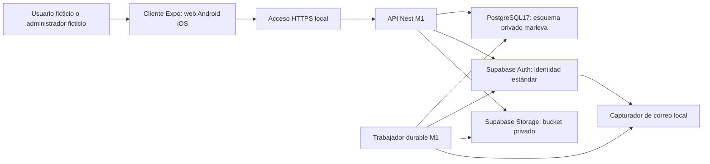
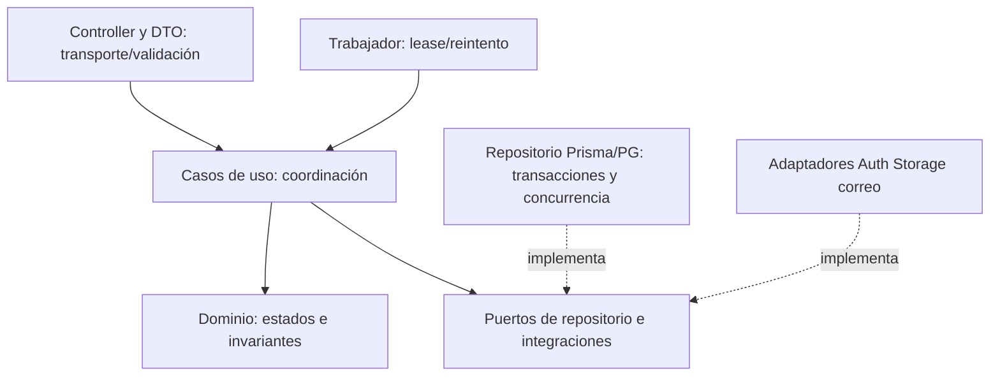

# Proceso de desarrollo y auditoría de Marleva

Historial por Git. Fecha: 13-10-2026 America/Merida. MAR-CHAT-004 continúa abierto. Instrucción vigente del usuario: documentación revisable antes de desarrollo; pruebas para cada cambio de backend/frontend; instalaciones correctas, homogéneas y sin componentes sin identificar. No acredita implementación completa ni conformidad con estándares.

## Lectura obligatoria antes de cada proceso o cambio

1. Instrucciones vigentes del usuario y AGENTS.md aplicable.
2. [00 Guía](../../../../entregables/fuentes_finales/00_GUIA_PRINCIPAL_MARLEVA.md), [01 Estado](../../../../entregables/fuentes_finales/01_ESTADO_Y_DECISIONES_MARLEVA.md), [02 Diseño](../../../../entregables/fuentes_finales/02_MVP1_ALCANCE_Y_DISENO_MARLEVA.md), [03 Evidencia](../../../../entregables/fuentes_finales/03_REFERENTES_Y_EVIDENCIA_MARLEVA.md).
3. Este documento; registro de procesos/casos del módulo; diagramas afectados; modelo DBML y DDL; OpenAPI YAML; pruebas y resultados pertinentes.
4. Inventariar cambios y leer los archivos afectados completos. No usar una lista o búsqueda como lectura completa. No divulgar secretos ni declarar leídas dependencias/cachés/artefactos generados.

Si hay una contradicción entre diseño, diagrama, modelo, API o código, registrarla y corregir la documentación antes de implementar. Si falta una decisión material, detener únicamente el trabajo que depende de ella. Las autorizaciones previas de desarrollo/SDK se conservan; no autorizan publicación, datos reales o dinero real.

## Todas las observaciones del usuario y contraste real

| ID | Requisito/observación | Contraste con fuentes y archivos | Estado y salida necesaria |
|---|---|---|---|
| R01 | Saber dónde está el proyecto | 02 §16 A3 preveía marleva-local; ubicación actual marleva-local/repositorio | Reubicación hecha; rutas y arranque tras traslado por verificar |
| R02 | Carpeta específica para el repositorio | Antes no había .git; ahora existe .git local en repositorio | Sin remoto, commits o subida |
| R03 | Saber dónde está gitignore | Existe .gitignore en raíz del repositorio | Exclusiones de .env, claves, herramientas, dependencias, Prisma generado y APK comprobadas con git check-ignore; revisión completa de publicables pendiente |
| R04 | Instalaciones correctas y homologadas | 02 A1–A5/16.2; manifiesto y toolchain existentes | Herramientas verificadas parcialmente; reinstalación limpia y estado tras traslado pendientes |
| R05 | Documentación lista antes de desarrollar | 00 §7 y C08 ya lo exigían; 02 documental no reemplaza contratos/diagramas revisables | Se avanzó demasiado pronto; se detiene implementación para cerrar esta revisión |
| R06 | Lectura obligatoria del proceso e instrucciones | 00 y AGENTS exigían lectura de fuentes, faltaba protocolo técnico enlazado | Este documento y AGENTS del repo; texto de instrucciones para pegar actualizado |
| R07 | Enumerar y validar todo contra archivos | Fuentes 00/01/02/03, antecedentes y código propio | Esta matriz; inventario y límites de lectura; no afirmar auditoría exhaustiva de dependencias |
| R08 | Arquitectura explícita | C22 PostgreSQL, C23 Nest/TS, C24 Expo/TS, C07 separación | Arquitectura modular por capas concretada abajo; código actual aún no coincide |
| R09 | Separar back en controller/service/DTO/entity/repository | Hay controller.ts/account.service.ts, sin DTOs/repositorios por módulo | Refactor pendiente después de revisión documental; no crear capas vacías |
| R10 | Separación de carpetas del front y back | apps/client y apps/api existentes | Cliente deberá separarse por módulo, casos y componentes; pantalla monolítica actual pendiente |
| R11 | Pruebas unitarias en cada desarrollo | Simulador/configuración tienen pruebas; no toda lógica M1 ni cliente | tests/unit/backend y frontend; completar casos antes de cerrar cada cambio |
| R12 | Pruebas de integración por casos de uso | 13 pruebas en última corrida anterior, más recorrido Chrome | Reubicadas/separadas, IDs de11 integración backend y9 unitarias; faltan casos/plataformas de 02 §16.4 |
| R13 | Pensar como tester en back y front | 02 §14/16.4 ya contenían errores/permisos/recuperación | Éxito, negativos, límites, concurrencia, caídas, recuperación, accesibilidad y regresión |
| R14 | Pruebas de performance | No se habían ejecutado mediciones | Carpetas backend/frontend y plan medible; no inventar tiempos o capacidad |
| R15 | Carpetas para pruebas/resultados/casos | Antes pruebas API y evidencias mezcladas | Estructura por tipo/lado/módulo; resultados con fecha, ambiente y límites |
| R16 | Diagramas de secuencia por módulo | 02 tenía diagramas generales; no archivos por proceso M1 | docs/diagramas/secuencia/M1 y carpetas M2–M10; matrices de procesos; pendientes identificados |
| R17 | Modificar pantallas primero mediante secuencias | No se presentó esa trazabilidad antes de la interfaz | Secuencia/estado/API/prueba primero; propuesta visual y revisión después; no tratar colores actuales como aprobados |
| R18 | Nomenclatura para localizar errores y corregir el diagrama | IDs C/M/B existentes; faltaban IDs de UC/SEQ/STEP/TEST/BUG | Estándar abajo, IDs estables y tabla de trazabilidad |
| R19 | Carpeta de modelado de datos en DBML | Prisma + SQL existen, DBML ausente antes de este pedido | DBML M1 revisable y DDL exportado; alcance global futuro separado de esquema implementado |
| R20 | Abrir DBML en dbdiagram.io/d | Sintaxis/exportación oficiales comprobadas; ejemplos del usuario no recibidos | Archivo sin secretos para importar/pegar; no se publica ni crea cuenta por hacerlo local |
| R21 | DDL generado a partir del DBML | Migración 001 vacía y 002 SQL manual aplicada antes | Exportación DBML→DDL; comparación pendiente con esquema real; no reescribir migraciones aplicadas |
| R22 | APIs YAML documentadas con Swagger revisable | Existe OpenAPI3.1.1 JSON y tipos generados; no YAML/Swagger visible previo | YAML canónico M1, JSON/tipos/preview derivados; revisión antes de nuevas implementaciones |
| R23 | Usar ejemplos DBML/YAML enviados | No hay adjuntos accesibles en los mensajes recibidos | Pendientes; no reconstruidos ni afirmados leídos; adaptar cuando estén disponibles |
| R24 | Secuencia de chats y entrega de documentos | 001–003 cerrados; 004 abierto y autorizado. Fuentes no se actualizaron oportunamente durante ejecución | Corregir 01 y continuidad; no saltar a005 ni usar FIN mientras se ordena este tema |
| R25 | Entregar documentos accesibles y ubicación real | sources/ZIP siguen1.0; solo escrituras locales | Versiones finales enlazadas y releídas; carga compartida no realizada |

## Arquitectura y estándar de programación

Base confirmada: monolito modular NestJS/TypeScript con API REST; cliente universal Expo/React Native/TypeScript separado; PostgreSQL17 central; Prisma7 para persistencia. Supabase local provee identidad/archivos. No microservicios ni arquitectura privada de referentes inferida. Capas: transporte → aplicación → dominio; aplicación usa puertos de persistencia e integraciones que implementa infraestructura. No llamar implementada una arquitectura por dibujar sus carpetas.

| Carpeta por módulo backend | Responsabilidad | Prohibición |
|---|---|---|
| modules/m1/presentation/controllers | HTTP, entrada/salida y códigos de respuesta | SQL, decisiones de negocio o importes |
| modules/m1/presentation/dtos | DTO: estructura de solicitud/respuesta y validación de ejecución conforme OpenAPI | Aceptar roles/importes arbitrarios del cliente |
| modules/m1/application/use-cases | Un caso de uso por operación; coordina reglas, transacción y puertos | Depender de detalles HTTP/SDK en reglas |
| modules/m1/application/ports | Contratos concretos de repositorio, identidad y correo | Adaptador genérico vacío para todo motor |
| modules/m1/domain/entities | Identidad, estados e invariantes de cuenta/sesión/desafío | Confundir entidades de dominio con modelos ORM |
| modules/m1/domain/services | Reglas que afectan más de una entidad | Llamadas a proveedor o base |
| modules/m1/infrastructure/repositories | Prisma/PG y operaciones atómicas, sin filtrarse a controller | API accediendo tablas de otros módulos para saltar reglas |
| modules/m1/infrastructure/adapters | Supabase/SMTP detrás de puertos pequeños | service_role o refresh tokens en cliente |
| shared y config | Errores, validación, configuración y controles transversales con función real | Convertirse en contenedor de toda lógica |

Frontend: app/ mantiene rutas; src/modules/m1 separa pantallas, componentes, casos de uso y adaptadores API/sesión por plataforma. El contrato generado tipa solicitudes/respuestas; los tipos no sustituyen validación del servidor. Credencial móvil en SecureStore; web en cookie HttpOnly/Secure con origen/CSRF. No pantallas aisladas ni regla comercial confiada al cliente.

TypeScript estricto; nombres de código en inglés, mensajes de usuario en español; archivos con responsabilidad definida; DTOs formales, estado/errores explícitos, pruebas de límites y concurrencia. Fijar formato/lint y versiones compatibles antes del refactor. Inyección de dependencias de Nest; evitar any y Record genérico en contratos de negocio. Imports entre módulos por contratos públicos. Migraciones inmutables una vez aplicadas. Sin secretos/datos reales en Git/logs/resultados. No se acredita todavía cumplimiento de estos criterios por el código actual.

## Estructura obligatoria

```text
marleva-local/repositorio/
  AGENTS.md README.md              Git y .gitignore únicos en raíz del proyecto
  apps/api/                         API y módulos backend
  apps/client/                      cliente y módulos frontend
  packages/contracts/               tipos/JSON generados desde YAML
  packages/config/                  configuración común usada
  infra/local/                      herramientas, manifiesto, Supabase y secretos ignorados
  docs/proceso/                     este protocolo, auditoría, trazabilidad
  docs/diagramas/secuencia/M1..M10/  Mermaid por caso, con pasos estables
  docs/modelado-datos/dbml/          modelo fuente
  docs/modelado-datos/ddl/           SQL generado para revisión, no migración automática
  docs/apis/M1..M10/                 OpenAPI YAML y revisión Swagger
  tests/unit/backend|frontend/M1/   pruebas de unidades y reglas
  tests/integration/backend|frontend/M1/  recorridos y componentes reales
  tests/performance/backend|frontend/M1/  cargas, tiempos y métricas
  tests/fixtures/                   solo datos ficticios
  tests/results/                    actas/reportes; sin secretos
  scripts/                         generación, comprobación y operación
  artifacts/                       builds identificados, ignorados en Git
```

Las carpetas reservadas no acreditan contenido implementado. Todos los nuevos módulos siguen el mismo esquema, sin construir M2–M10 completos durante base/M1. Documentación funcional global sigue en02; este protocolo define cómo desarrollar y comprobarla.

## Nomenclatura y trazabilidad

| Artefacto | Formato | Ejemplo |
|---|---|---|
| Requisito de esta corrección | MAR-Rxx | MAR-R19 |
| Caso de uso | MAR-Mn-UC-xxx | MAR-M1-UC-001 |
| Secuencia | MAR-Mn-SEQ-xxx | MAR-M1-SEQ-001 |
| Paso estable del diagrama | Sxxx dentro de SEQ | MAR-M1-SEQ-001:S030 |
| Operación API | MAR_Mn_API_xxx | MAR_M1_API_001 |
| Pantalla | MAR-Mn-UI-xxx | MAR-M1-UI-001 |
| Prueba | MAR-Mn-UT/IT/PF-BE/FE-xxx | MAR-M1-IT-BE-001 |
| Incidencia | MAR-Mn-BUG-xxx | MAR-M1-BUG-001 |
| Modelo/DDL | MAR-Mn-DATA-xxx | MAR-M1-DATA-001 |

Cada incidencia indica caso, diagrama:paso, pantalla/API/campo, condición de reproducción, resultado esperado/real y prueba de regresión. No renumerar IDs por insertar pasos; usar espacios S010/S020/S030 y nuevas etiquetas. Corregir el diagrama primero, luego contrato/datos y código, finalmente la prueba. Una secuencia describe comunicaciones y decisiones; no sustituye estados, validaciones o revisión visual.

## Puertas antes y después de cada cambio

1. Leer, comprobar autorización y limitar el cambio al módulo/caso.
2. Registrar entradas, reglas, estados, actor, errores y recuperación. Relacionar UC→SEQ/paso→API→datos→pantalla→pruebas.
3. Revisar/actualizar Mermaid, DBML, DDL y OpenAPI YAML. Presentarlos para revisión. Una propuesta visual no se implementa sin revisión correspondiente.
4. Definir pruebas unitarias e integración necesarias para backend y frontend; performance proporcional al cambio y regresión. Definir condiciones/objetivos antes de medir.
5. Generar y comprobar artefactos antes de implementar: DBML→DDL; YAML→JSON/tipos/Swagger. Revisar diferencia y migración; no aplicar el DDL completo sobre una base existente.
6. Implementar solo después de coherencia documental. No crear clases, rutas o carpetas vacías como si fueran arquitectura terminada.
7. Ejecutar pruebas; registrar ambiente/versión/dataset/comando/esperado/obtenido, fallos, corrección y límites. No usar tests que solo repiten el código o casillas sin evidencia.
8. Releer finales completos, validar enlaces/contratos/modelo, actualizar solo fuentes afectadas y entregar enlaces/ubicación/subida. Módulo incompleto continúa; chat abierto no se cierra por una duda.

## Plan de pruebas y performance

Unitarias backend: estados/transiciones, caducidad, cooldown, revocación, rol, límites de cambio de correo, cifrado con bibliotecas estándar, simulador. Frontend: validación, estados de carga/error, espera/reenvío, sesión vencida, navegación, adaptación web/nativo y prevención de doble envío. Integración backend: PG/Auth/SMTP reales locales, dos actores, concurrencia y caídas; frontend: cliente+API en Chrome/Safari y builds Android/iOS, con accesibilidad.

Performance backend: salud frente a cuenta autenticada, paginación de avisos, refrescos concurrentes, saturación/recuperación y límites de abuso. Dataset y sesiones ficticias preparadas; no medir límiteOTP como capacidad de negocio. Registrar concurrencia, duración, warmup, p50/p95/p99, solicitudes/s, errores, CPU/RAM y versiones. Frontend: carga, tamaño de bundle, tiempos de interacción/red, renders y memoria en dispositivo/viewport identificados. Chrome no acredita Safari ni dispositivo físico. Sin umbrales productivos aprobados: objetivos locales deben definirse como criterios de ingeniería revisables, separados de compromisos del piloto. No existen aún resultados de performance.

## Estado de auditoría y trabajo siguiente

Hechos anteriores al traslado:13 tests pasaron en última corrida; recorrido Chrome por HTTPS validado pasó; instalación frozen conservó hash; APK debug ARM64 inicial compiló e instaló. Recompilación posterior fue interrumpida: log no contiene cierre exitoso; no acreditarla. Android no completó recorrido: primer arranque falló por política de Metro, corregida documentalmente/en configuración pero todavía sin prueba final. iOS/Xcode no comprobados. Usuario instalará Xcode y aceptará licencia; solo iPhone físico disponible. Restablecimiento aislado, archivos privados, recuperación MFA, caídas/outbox y cobertura completa de02 §16.4 siguen pendientes. Las pruebas existentes no cubren estos faltantes.

Servicios de aplicación/Supabase/VM detenidos para esta revisión, con datos conservados. Autorización A0 y SDKAndroid vigente. Próximo paso: revisar matriz, procesos, DBML/DDL y YAML/Swagger; recibir ejemplos si existen; cerrar diferencias antes de refactor y de revisar diseño visual. No iniciar M2 ni declarar M1 completa. Chat004 conserva su ID. El acceso en otra conversación debe comprobarse; no hay vía de carga compartida comprobada ni subida realizada. Esto no bloquea el trabajo local autorizado.


## Brechas verificadas en archivos propios y prioridad de corrección

| Incidencia | Evidencia actual | Corrección antes de declarar cumplimiento |
|---|---|---|
| MAR-M1-BUG-001 arquitectura | AccountService importa Prisma/Supabase y concentra casos; controller acepta Record; cliente api Promise<any> e index monolítico | Contratos/DTOs/puertos/casos/repositorios reales, separar cliente, fijar formato/lint; no módulos vacíos |
| MAR-M1-BUG-002 datos | EmailChange.accountId sin FK; roles boolean y estados text sin catálogo/check; Audit conservación incompleta | Diseñar relaciones/invariantes y migración revisable; comparar DBML/DDL/Prisma/DB |
| MAR-M1-BUG-003 generación SQL | DBML exporta FKs DEFERRABLE; SQL aplicado no. Exportado añade CREATE SCHEMA/comentarios, no GRANT/REVOKE | Diferencias no equivalentes; DDL revisión, no reemplazo automático de migraciones |
| MAR-M1-BUG-004 API | YAML errores repetidos genéricos, sin Health ni cabeceras Origin/native/CSRF/Retry-After/Set-Cookie detalladas; DTO runtime no valida additionalProperties | Completar contrato y pruebas de petición/respuesta con códigos específicos; no confundir parser con coherencia |
| MAR-M1-BUG-005 avisos | SEQ008:S080 dice paginada; código retorna50 y next_cursor:null | Documentar límite actual; diseñar cursor/estados/errores y probar antes de implementar |
| MAR-M1-BUG-006 recovery | MFA recuperación/revocación administrativa y Storage privado/restauración no completos | Cerrar casos16.4/B09/B12 sin transferir cuentas por comprobante vecinal |
| MAR-M1-BUG-007 sesiones/concurrencia | Cuotas/origen compartido, refresh lease/caídas/caducidades requieren más pruebas; Retry-After fijo60 | Casos de límites, concurrencia, caídas y reconciliación; tiempos reales consistentes |
| MAR-M1-BUG-008 prueba engañosa | Test nuevo/existente crea dos correos nuevos | Corregir fixture y probar cuenta existente de verdad; título no acredita caso |
| MAR-M1-BUG-009 móviles | Build Android posterior interrumpido; Xcode/iOS físicos no comprobados | Rehacer build/recorridos tras traslado, conservar pendientes físicos |
| MAR-M1-BUG-010 performance | Readiness crea/desconecta Prisma por llamada; ningún resultado de carga | Plan de casos autenticados y recursos, medir sin prometer capacidad |
| MAR-M1-BUG-011 entrega/continuidad | Fuentes quedaron desactualizadas durante ejecución | Fuentes locales corregidas, prompt004 continúa; subir versiones reales cuando corresponda |

Las secuencias están en revisión: describen comportamiento parcial y objetivo; leer estado y estas diferencias. Pruebas unitarias nuevas:9/9 pasaron; primera corridafrontend falló por resolver React Native Flow y se corrigieron mocks del entorno de tests. No prueba UI completa. Instalación frozen offline posterior al traslado pasó; no peer conflicts nuevos observados. No certificación de seguridad/arquitectura/estándares.

Estado fuera del repo identificado: perfil marleva/VM/volúmenes en ~/.colima, estado CLI en ~/.supabase, adb en ~/.android, CA pública de desarrollo confiada en llavero login. Herramientas/descargas/certificados privados y cachesGradle/AVD están bajo infra/local ignorado; no portabilidad total acreditada. Docker archive SHA local calculado no equivale a checksum remoto verificado. Actualizar manifiesto después de cerrar revisión y reiniciar autorizadamente, manteniendo la captura anterior como histórica.


## Continuación13-10-2026: documentación vinculada

Leer [matriz M1 de casos/estados/pruebas](MATRIZ_CASOS_M1.md) antes de cada proceso o cambio, con protocolos/diagramas/modelo/API. YAML0.2.0 describe14 operaciones parciales observadas, Health ycabeceras/condiciones, errores ybrechas. No se implementaron endpoints adicionales ni UI. SEQ008:S080 corregido a límite actual50/cursor null. DDL exportado ahora conserva NOT DEFERRABLE mediante transformación explícita; no aplica privilegios/bootstrap ni modifica DB. BUG003 corrección documental comprobable, cotejoDBviva pendiente; BUG004/005 coherencia descriptiva mejorada, runtime/contratoobjetivo pendientes. No cerrar BUG001/002/006–010 por estos documentos.

Fuentes e instrucciones se actualizan localmente; indicar versiones finales y texto actualizado, sin atribuir al usuario una carga por una vía no disponible. No hay subida automática comprobada; sources/ZIPoriginal intactos. Pruebas≥100 son planes, umbralesperformance propuestos, no ejecución/aprobación comercial. Próximo: cerrar datos/roles/estados ycontratos de recuperación/Storage yramas de fallos, después refactor/pruebas autorizadas. El código de negocio ypantallas siguen detenidos.

Avance efectivo13-10-2026: modelo objetivo DATA002/DDL separado deDATA001, roles revocables/recuperaciónMFA/B09 ySEQ014. Leer docs/modelado-datos/README.md antes de continuar; invariantesSQL parciales/contratosobjetivo/pruebas/migración siguen por cerrar. No se aplicaDDL ni se acredita implementación. Retirada indicación de subirZIP aFuentes: vía no disponible segúnusuario; toda entrega es local hasta comprobar acceso.


## Puerta documental de recuperación / DATA002

Contratoobjetivo recuperación ahora incluye7 operaciones: solicitud, consulta, aprobación, capacidad, enrolamiento, verificación yrechazo, conerrores/Origin/native/CSRF/idempotencia. Solo objetivo; código actual permanece14 operaciones originales. SQLcomplementaDBML conrestriccionesparciales/checks; generador scripts/generate-m1-target.mjs mantieneDDL ySwaggerobjetivo.8 pruebasSQLaisladas pasaron, conprimerfallo dearranque conservado. No declara completadoMFA/B09 ni todaM1. Ver matriz para IDs/resultados/límites. Leer contratoobjetivo yDATA002 ademásde físicos; antes de refactor comprobar diferencias delosdemásprocesos/Storage, migración ypruebas.


## Ruta única de corrección y ejecución — 13-10-2026

Plan de trabajo derivado de la solicitud del usuario de evitar redundancias y ciclos. No acredita pasos ejecutados ni amplía MVP1. Mantener C01–C26 y autorizaciones; no rehacer descubrimiento o selección de stack sin causa documentada. Esta sección reemplaza el uso de anuncios sucesivos como plan de ejecución.

| Orden | Trabajo y salida | Condición para avanzar |
|---|---|---|
| 1 | Actualizar inventario desde raíz y registro de lectura de nuevos/modificados; separar vigentes, antecedentes, dependencias y ausentes; corregir textos históricos ambiguos | Rutas/versiones/hashes actuales, lectura explícita y ningún dato ausente presentado como leído; sin editar sources |
| 2 | Administrar una sola lista de pendientes en matriz/protocolo existentes: ID, dependencia, responsable, riesgo, estado y evidencia de salida | Una tarea de implementación activa; dependencias externas separadas; sin volver a pedir A0/SDK |
| 3 | Cerrar arquitectura M1: contexto y componentes principales, límites de capas, permisos, transacciones, proveedores, configuración y operación | Responsabilidades y decisiones técnicas justificadas; formato/lint y validación elegidos/fijados antes de refactor; ninguna capa vacía |
| 4 | Cerrar documentación M1 en orden de dependencia: salud/configuración; OTP/sesiones; cambio de correo/roles/MFA/recuperación; avisos; B09; simulador aislado; B12 | Por caso coinciden regla/estado/SEQ/paso, DBML/DDL, OpenAPI/errores y pruebas. B09 pendiente concreto; no cerrar solo Markdown ni parser |
| 5 | Preparar propuesta visual M1 desde secuencias cerradas: estructura, textos, componentes y carga/vacío/error/recuperación, web/nativo y accesibilidad | Usuario puede revisar y se registra su decisión antes de implementar pantallas; referencias visuales pendientes no bloquean datos/API |
| 6 | Comprobar base y herramientas tras traslado: pins, licencias/permisos, rutas, lockfile, imágenes, configuración, secretos, puertos y arranque/parada | Evidencia real reproducible; comprobar lo instalado y corregir solo brechas; no reinstalar por costumbre. Xcode/licencia por verificar; falta Android físico |
| 7 | Refactor e implementar un caso completo según orden del paso4, con prueba de comportamiento actual válido antes de cambiarlo | Capas reales, DTO runtime y contrato coherentes; migración nueva revisada y ensayada aisladamente; frontend integrado cuando corresponde; sin reescribir migraciones aplicadas |
| 8 | Comprobar cada incremento: unitarias, integración real, contrato, negativos/permisos/concurrencia/caídas, frontend/accesibilidad, performance pertinente y regresión | Reporte esperado/obtenido/versiones/dataset/plataforma; fallos corregidos o dependencia explícita. No mocks como integración real ni títulos como cobertura |
| 9 | Cerrar base/M1: instalación/arranque aislados, restauración PG/Auth/Storage, reaplicar borrados/revocar sesiones y matriz web/Android/iOS | Todos los criterios02 §16.4 comprobados. Pruebas físicas pendientes impiden acreditar cierre completo; no avanzar M2 como si M1 terminara |
| 10 | Entregar incremento verificado: finales completos releídos, enlaces, fuentes afectadas, actas, continuidad y archivos Git publicables revisados | Local/subido/commit distinguidos; vía compartida pendiente no bloquea trabajo local. Tema004 continúa hasta condición real de cierre |

Pasos1–6 preparan/corrigen la base una vez;7–8 se repiten por caso,10 acompaña cada incremento;9 es cierre integrado. No esperar al paso10 para registrar una decisión o fallo. Ante un fallo, volver solo al paso que lo causa y ejecutar regresión de lo afectado. No repetir todo el ciclo sin cambio relevante.

La arquitectura no necesita todas las vistas posibles: contexto y aplicaciones/almacenes primero; detalle de componente solo donde aclare una responsabilidad. DBML es fuente de datos; DDL derivado con restricciones complementarias trazadas. YAML es fuente API; JSON/tipos/Swagger derivados. Diagramas de secuencia modelan proceso y comunicaciones; la propuesta visual resuelve distribución, interacción y accesibilidad. Cada artefacto tiene una función distinta.

Medir trabajo: casos verificados/frente pendientes, fallos por severidad, tiempo de cierre de caso, retrabajo causado por contrato/datos inconsistentes y tiempo/memoria/errores de ejecución. No inventar fechas ni considerar número de archivos como progreso. Mejora continua al cerrar un incremento: identificar un problema observado, corregir su causa y comprobar si baja retrabajo/error/tiempo; ideas ajenas al alcance van a lista para después. Simplificar no elimina controles necesarios.

Referencias primarias consultadas13-10-2026: [GOV.UK: gobernanza ágil](https://www.gov.uk/service-manual/agile-delivery/governance-principles-for-agile-service-delivery), [C4: diagramas según valor](https://c4model.com/diagrams), [OpenAPI](https://www.openapis.org/), [NIST SSDF](https://csrc.nist.gov/Projects/ssdf), [WCAG2.2](https://www.w3.org/TR/WCAG22/). Adaptación propuesta para Marleva, no certificación o cumplimiento acreditado. Los procesos existentes orientan decisiones; las mediciones locales validan su aplicación.

Cambio1.2: ruta explícita con salidas y tratamiento de fallos para evitar reinicios y entregas parciales sin continuidad. No cambia decisiones de producto ni autoriza operaciones externas.

Cambio1.3,13-10-2026: conciliación del inventario y lectura, corrección del orden generación/implementación y retiro de obligación de carga por vía no comprobada. Las brechas históricas de la tabla BUG se leen junto a sus correcciones posteriores; no todas siguen sin cambio. Modelo objetivo existente no equivale a esquema aplicado; B09 sigue parcial.

## Continuidad autónoma dentro del trabajo autorizado

Instrucción explícita13-10-2026: ejecutar el plan sin esperar confirmación entre tareas ordinarias. Después de cada tarea, comprobar su salida, registrar resultado/fallo, seleccionar la siguiente dependencia y continuar. Las actualizaciones informan avances; no son solicitudes de permiso. No finalizar un turno solo por terminar una subtarea si queda trabajo autorizado ejecutable.

Detener únicamente la acción afectada por una instrucción de pausa, decisión material de alcance/diseño que requiera al usuario, gasto/publicación/contratación/contactos/datos o dinero reales, licencia/permiso no resueltos, o un bloqueo que no pueda resolverse dentro de autorización. Explicar causa y avanzar en tareas independientes. Conservar autorizaciones y decisiones vigentes; no interpretar silencio como aprobación. Ninguna regla promete ejecución cuando no existe una sesión activa o acceso efectivo.

Revisar efectos de cada cambio sobre artefactos y pruebas existentes; corregir retrospectivamente las inconsistencias causadas sin reabrir acuerdos por costumbre. Mejoras justificadas por defecto observado, riesgo concreto o medición; ideas que amplían MVP1 van a lista posterior. Una tarea se cierra con evidencia, no con un anuncio. La ruta y los pendientes viven en protocolo/matriz existentes;01 registra estado/continuidad,02 diseño,03 evidencia,00 reglas.

## Cola activa de base/M1

| Orden/ID | Trabajo | Dependencia | Estado y salida |
|---|---|---|---|
| P01 | Conciliar inventario/contexto | Ninguna | Hecho13-10; mantener por cambios, no repetir sin motivo |
| P02 | Arquitectura operativa/documental y criterios de programación | P01 | En curso: completar vistas/responsabilidades; formato/lint fijados antes de refactor |
| P03 | Cerrar contratos/datos/errores/pruebas M1, incluyendo B09 y B12 | Vistas/responsabilidadesP02; independiente de formato | En curso: procesar matriz por dependencia, validar generados sin confundir ejecución |
| P04 | Propuesta visual revisable M1 | P03 para procesos de pantalla | Pendiente de revisión de diseño; no detiene contratos/backend independiente |
| P05 | Entorno tras traslado y permisos móviles | P01; no depende de estética | Verificación pendiente, sin reinstalar lo correcto; Xcode/licencia/físicos no acreditados |
| P06 | Implementar/refactorizar y probar por caso completo | P03/P05; P04 para pantalla | Pendiente, una tarea activa; planificar y ejecutar unitarias/integración/performance/regresión |
| P07 | Restauración/repetibilidad/plataformas y entrega M1 | P06 | Pendiente02 §16.4; solo cerrar con evidencia |

Responsable de ejecución/documentación/pruebas: asistente. Usuario interviene en decisiones materiales y acceso/licencias/dispositivos que requieren su actuación. Datos y pruebas ficticios; sin nuevos responsables reales inventados. Estados implementado/probado/completo separados. Prioridades por dependencias y riesgo, no por cantidad de archivos.

Cambio1.4: regla de continuidad y cola única para ejecutar sin pedir confirmaciones rutinarias. Lectura/contexto conciliados; siguiente P02, después P03. Las condiciones anteriores se mantienen.

## Arquitectura operativa M1 — P02

Estado: diseño objetivo sobre base parcial, no separación implementada. No añadir microservicios. La API modular es dueña de reglas y datos de negocio; los servicios del proveedor conservan sus esquemas. El trabajador comparte casos/puertos de la API y ejecuta tareas durables; no es un segundo dueño de tablas. Administración futura corresponde al cliente autorizado y roles, no a acceso general a PostgreSQL.



Este diagrama expresa aplicaciones/almacenes y flujo objetivo; no acredita arranque tras traslado, operación de B09 o plataformas. Cliente nunca recibe service_role ni consulta tablas de negocio directamente. Proxy y cliente no toman decisiones de permisos.



Dependencia del código hacia dominio/puertos; detalles de HTTP/Prisma/SDK no entran en reglas. Un controller no abre transacciones ni cambia roles. Un repositorio no decide qué pantalla mostrar. Usar inyección Nest para implementaciones reales; extraer servicios de dominio solo si una regla lo necesita.

| Aspecto | Decisión y comprobación |
|---|---|
| Atomicidad | Transición, registro mínimo y tarea/outbox se guardan en transacción corta. Proveedor fuera de transacción; referencia idempotente y reconciliación ante resultado desconocido. Probar caída antes/después de commit/proveedor. |
| Autorización | Identidad, sesión vigente, cuenta/rol actual, recurso y finalidad comprobados por caso. Repositorio restringe consultas al recurso autorizado; tests A/B, revocación y carreras. |
| Migraciones | Prisma/SQL de negocio modifica marleva; Supabase gestiona Auth/Storage. DATA001 fotografía, DATA002 objetivo. Revisar nueva migración en destino aislado y cotejar datos/permisos; no DDL completo sobre negocio. |
| Credenciales | Cookie opaca web con HTTPS/CSRF; SecureStore móvil. Secretos proveedor cifrados en servidor y fuera de Git/log. Revocación no depende de JWT viejo. |
| Configuración | Validada antes de arranque, modo real bloqueado, versiones/imagen reales fijadas y destinos locales identificados. Health/live no acredita dependencias; ready sí comprueba con timeout. |
| Fallos | Errores OpenAPI estables con request_id/acción recuperable; no stack ni existencia ajena. Consultar resultado antes de repetir mutación. |
| Observabilidad | Metadatos de operación/caso/duración/resultado sin cuerpos secretos; métricas útiles para pruebas. No incorporar plataforma externa por conveniencia. |
| Cambio de código | Tipado estricto/DTO runtime/imports por contratos, responsabilidad por archivo, formato/lint fijados antes de refactor. No reescribir aplicación completa ni mover archivos como prueba de arquitectura. |

Conservar código actual para pruebas de caracterización de comportamiento válido. Identificar el caso que se extrae, mantener contrato y corregir defectos conocidos con regresión; no preservar un fallo porque estuviera implementado. P02 no se declara completo hasta cerrar herramientas de formato/lint y límites de componentes contra archivos reales. Esta vista permite continuar P03 de datos/contratos que no depende de esa instalación.

Avance P03/B09,13-10-2026: contratoobjetivo3operaciones, Swagger yDATA00213tablas generados;10SQL114–123 pasaron enPG17 desechable conlimpieza. No código de negocio/migración/API/Storage/UI nuevos. P02 mantiene formato/lint pendiente; P03 continúa revisión de demáscontratos/ramas yB12. No cerrar M1 ni volver a conciliaciónP01 por una duda. Apertura004 registrada: al retomar anunciar CONTINUACIÓN; no repetir INICIO, no FIN hasta cerrar tema con plantilla00 yprompt revisado.

P02herramientas de calidad,13-10-2026: versiones del registro oficial consultadas: ESLint10.12.0,@eslint/js10.0.1,typescript-eslint8.71.2,Prettier3.9.10,globals17.13.0,eslint-plugin-react-hooks7.1.1. LicenciaMIT según metadatos. Node24.21.0 cumpleengines; typescript-eslint peerTypeScript>=4.8.4<6.1.0 admite6.0.3 yESLint10; pluginhooks admite10. Selección rutinaria dentro deA4, no nuevoframework. Instalar exactas como devDependencies locales, lockfileúnico eignore-scripts; confirmar versión ycompatibilidad instalada. Prettier separado dellint para no duplicarreglas de formato; ESLintflatconfig para JS/TS yhookscliente, generados/caches excluidos. Registrar defectos existentes; no apagar reglas para aparentar conformidad ni formatear todo negocio antes derefactor. Fuentes: registry.npmjs.org por paquete, https://typescript-eslint.io/users/dependency-versions/ y https://prettier.io/docs/install. No instalación oconformidad acreditadas hasta comprobar.

P02calidad ejecutada: herramientas exactas instaladas; frozenoffline conservó lockfile. TypecheckAPI/cliente pasó y9unitarias pasaron. ESLint10errores, formato31archivos pendientes; acta tests/results/quality-baseline-20261013.json yprimeraconfiguración conservada. Falso positivo Playwrightdocument corregido conglobals de harnessfrontend, sin apagar reglas. Generadorobjetivo/testSQL formateados sin cambio decontenidoDDL/Swagger; no nueva corridaSQL innecesaria. Arquitectura de negocio sigue por refactor; calidadgeneral no aprobada. Xcodeactivo apuntaCLTools, xcodebuildfalla y /Applications noXcode encontrado, licencia no comprobada. Continuar P03antes de refactor concorrecciones trazadas, sinesperar respuesta ordinaria.

## Control de cambios y ejecución numerada

1. Entrada única: README en la raíz del proyecto; fuentes 00–03 y este protocolo según su orden.
2. Git está en la raíz, no en marleva-local/repositorio. Las referencias históricas a Git sin commits son antecedentes superados; estado vigente en 01.
3. Un archivo estable por función. Conservar antecedentes en Git, sin copias numeradas ni ZIP. Derivados se generan desde fuente; no reescribir migraciones ni eliminar actas de corridas distintas.
4. Cada proceso usa pasos estables Sxxx y trazabilidad de la matriz; cada tarea sigue las ocho puertas de este protocolo. Entrada, salida, fallos y evidencia identificados.
5. Avances reales al menos cada 60 segundos durante ejecución; resolver fallos y continuar tareas independientes. Chat abierto no acredita un proceso continuo.
6. Revisar diferencias e ignorados, releer finales y guardar commit local por incremento coherente. Fuentes e instrucciones incluidas en el mismo Git; remoto/subida separados.
