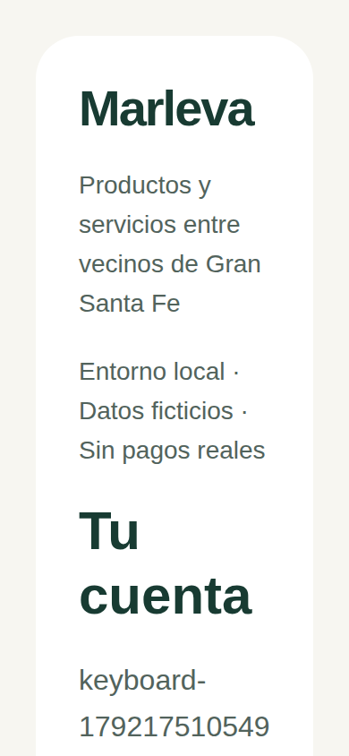
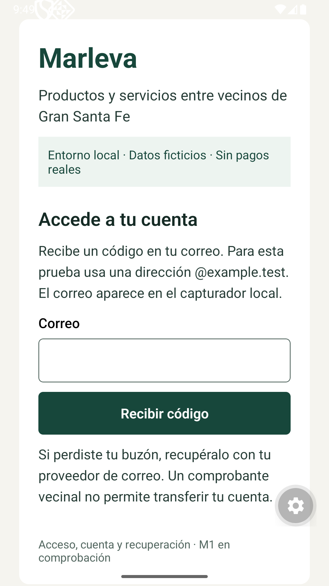
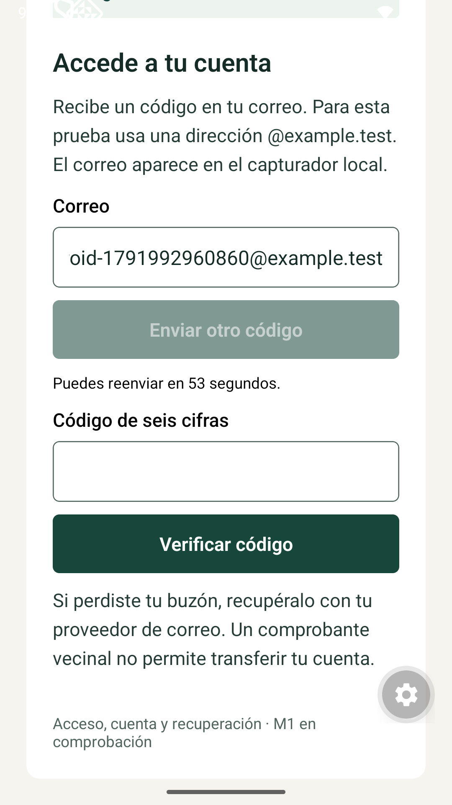
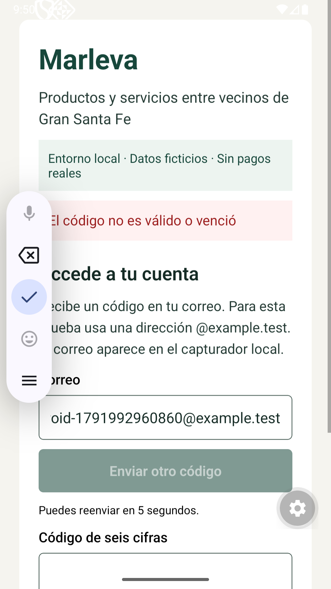
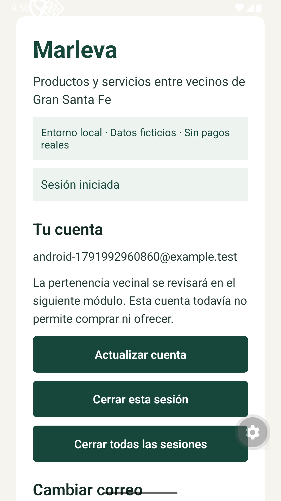
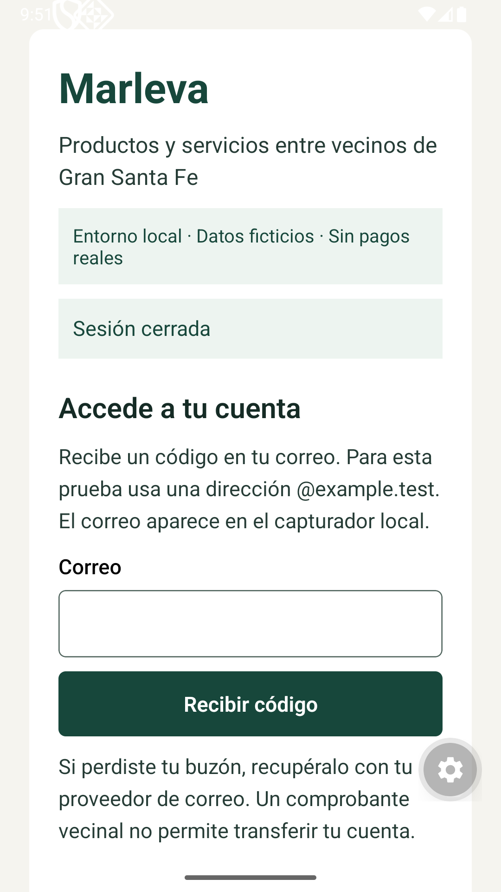

# M1: prueba de aceptación en Chrome

Fecha:16-10-2026, America/Merida. MAR-CHAT-009. Esta guía sustituye instrucciones parciales anteriores. Paquete de revisión Chrome comprobado en [CI38946169443](https://github.com/AndresRaRi/marleva/actions/runs/38946169443), código0d3b7ba; comprobar la integración y CI finales de PR14 antes de aceptar. La aceptación corresponde al usuario. Android/iOS están aplazados y apagados por instrucción del usuario; Safari no forma parte de esta revisión. No equivale a publicar Marleva ni a habilitar compras.

## Abrir y preparar la prueba

Abrir [Marleva local](https://localhost:8443) en Chrome y el [capturador local](http://127.0.0.1:54324) en otra pestaña. Usar una dirección nueva, por ejemplo `prueba-vecino-01@example.test`. Si ya existe un ensayo con ese correo, cambiar el número. Los correos solo llegan al capturador; no usar datos reales. Si los servicios están apagados, seguir el arranque conservando datos del [README del código](../../../README.md#arranque-de-este-entorno-preparado). No arrancar emuladores para esta revisión.

## 1. Acceso y error recuperable

1. Escribir el correo ficticio y pulsar **Recibir código**.
2. Escribir un código incorrecto: debe aparecer el error y conservarse el paso y el correo.
3. Buscar el mensaje correcto en el capturador y escribir su código vigente.
4. Pulsar **Verificar código**: debe aparecer **Tu cuenta** con el correo propio.
5. Recargar Chrome: la cuenta debe seguir abierta. Registrar el correo utilizado para las siguientes pruebas.

Espera de reenvío60s; código10min; cinco fallos bloquean15min. No acelerar cuotas ni relojes de la aplicación. Una cuenta normal no recibe permisos de operador ni pertenencia vecinal aprobada.

## 2. Cuenta, avisos y ayuda

Cambiar entre **Cuenta**, **Avisos** y **Ayuda**: deben cambiar el contenido y la pestaña seleccionada. **Actualizar cuenta** consulta de nuevo; **Cargar más avisos** añade la página siguiente y desaparece al terminar. Una cuenta nueva puede no tener avisos: debe mostrarse el vacío confirmado. Tras cambiar correo habrá un aviso propio. El ensayo automatizado prepara55avisos propios y comprueba tres páginas; no hay que insertar datos manualmente para aceptar el vacío de una cuenta nueva.

Si falla la conexión, conservar el paso y usar la acción de consulta/reintento. Si terminó la sesión, volver por OTP; una intención interna pertenece a esa cuenta y nunca debe ejecutarse con otra identidad ni repetir automáticamente una modificación.

## 3. Cambiar el correo

1. En **Cuenta**, escribir otra dirección ficticia en **Nuevo correo** y pulsar **Iniciar cambio**.
2. Buscar en el capturador los mensajes del buzón anterior y del nuevo.
3. En **Buzón que estás verificando** y **Código del cambio**, confirmar el primer buzón mediante **Confirmar buzón**.
4. Recargar: el cambio pendiente debe recuperarse. Un código incorrecto debe permitir corregirlo sin iniciar otro cambio.
5. Confirmar el otro buzón. Solo entonces se completa el cambio, se conserva la identidad de cuenta y se cierran sus sesiones anteriores.
6. Entrar por OTP al correo nuevo. Revisar el aviso de cambio. Para el ensayo, abrir previamente otra sesión del mismo correo en una ventana de incógnito; después del cambio tampoco debe conservar acceso.

Si la respuesta fue incierta, pulsar **Consultar cambio de correo** antes de repetir la acción. Si exige acceso reciente, iniciar sesión con un OTP nuevo. No cambiar el correo del usuario real.

## 4. Salida actual y salida total

**Cerrar esta sesión** devuelve al acceso. Recargar y volver por el historial no debe recuperar esa sesión. Para probar **Cerrar todas las sesiones**, entrar con el mismo correo ficticio también en incógnito, esperar60s si corresponde y usar un OTP nuevo. Ambas ventanas deben funcionar antes de la prueba. Pulsar la salida total desde una autenticación reciente; al consultar o recargar, ambas deben pedir acceso nuevamente.

## 5. Operador y segundo factor

Esta prueba usa exclusivamente un operador ficticio ya preparado y un autenticador local; una cuenta normal no se convierte en operador por escribir un correo especial. No conceder roles para probar una pantalla ni compartir claves del autenticador.

En **Cuenta**, sección **Acceso de operador ficticio**: comprobar que entrar solo por correo no permite operar; si no tiene un factor configurado, usar **Preparar segundo factor**, añadir la clave privadamente al autenticador y verificar **Código del segundo factor**. Si ya existe un factor, usar su autenticador vigente. **Comprobar permiso de operador** solo debe aprobar después de verificar el factor. La clave privada debe desaparecer después de verificar o salir; no guardarla en capturas.

## 6. Recuperación del operador

El recorrido completo ya tiene evidencia Chrome con dos operadores ficticios en un destino B12 restaurado. No repetir la retirada de factores en otros entornos: la autorización de borrado está limitada al factor ficticio perdido de ese ensayo.

Para revisar el comportamiento, usar esta secuencia y el [resultado integral](../../../tests/results/recovery-integral-1792167720153-browser-1792168307453.json):

| Paso | Resultado esperado |
|---|---|
| Titular: Ayuda → Motivo de recuperación → Solicitar recuperación | Solicitud en revisión y referencia propia |
| Intentar revisar la propia solicitud | Denegación; no conceder permiso por ser titular |
| Otro revisor autorizado con segundo factor: consultar referencia y aprobar | Aprobación por persona distinta y rol vigente |
| Trabajador retira exclusivamente el factor perdido autorizado | Sesión anterior termina; caída conserva proceso pendiente |
| Titular entra por OTP y vuelve a Ayuda | Recuperación propia y estado vigente, sin repetir solicitud |
| Solicitar autorización temporal → Preparar nuevo factor → Completar recuperación | Capacidad limitada a esa sesión, nuevo autenticador verificado y sesiones revocadas |
| Entrar otra vez por OTP y verificar nuevo factor | OTP solo no habilita operación; factor nuevo sí |

Los rechazos, caducidad, capacidad ligada, rol actual y caída/reinicio también tienen [pruebas backend](../../../tests/results/recovery-api.json). La recuperación del buzón corresponde a su proveedor; domicilio/nombre no transfieren cuentas. Google no es una función de esta entrega.

## 7. Teclado, lectura y ampliación

Repetir acceso, Cuenta/Avisos/Ayuda y salida sin ratón: Tab/Mayús+Tab y Enter. El foco debe ser visible, alcanzar controles y permitir corregir errores. Ampliar Chrome al200% y comprobar texto/controles sin desbordamiento horizontal. Revisar nombres de campos, mensajes y selección de pestañas con el lector de pantalla que utilice el tester. Las auditorías Axe/árbol accesible/teclado no sustituyen esa revisión humana ni acreditan WCAG completa.

## 8. Base sin pantalla de usuario

B09 es soporte de archivos privados ficticios, no un formulario de documentos M2. Su [contrato](../../apis/M1/CONTRATO_B09_ARCHIVOS_PRIVADOS.md) y [acta](../../../tests/results/files-increment.json) comprueban permisos e integridad. No borrar archivos para esta aceptación. UC012 es un simulador aislado; no hay compras, cobros ni reembolsos reales.

B12 esencial Chrome está probado y repetido desde el mismo backup: datos/Auth/Storage, atributos/hashes/relaciones, borrado autorizado reaplicado, revocación, cola, OTP/retorno, MFA y recuperación Prisma. [Procedimiento y actas](../../proceso/RECUPERACION_B12_M1.md). Tiempos de etapas no son un RTO; no se promete pérdida máxima, operación productiva ni pruebas de plataformas aplazadas.

## Registrar la aceptación

Recorrer1–4 y7 con una cuenta ficticia propia. Revisar5–6 con la evidencia del ensayo autorizado; no provocar otra pérdida de factor. Informar flujo/paso, esperado/obtenido y captura sin códigos o claves. Registrar cada recorrido como aprobado, con observaciones o no probado. La aceptación nunca se deduce del silencio. El [avance](../../avance.md) conserva implementación y aceptación separadas; [01](../../../../../entregables/fuentes_finales/01_ESTADO_Y_DECISIONES_MARLEVA.md) registra continuidad y límites. Android/iOS y revisión humana con lector permanecen identificados hasta probarlos.

## Revisar en Android emulado

APK debug ARM64 en apps/client/android/app/build/outputs/apk/debug/app-debug.apk, ignorado en Git; [acta de compilación](../../../tests/results/android-build.json). Requiere Metro local en8081. El emulador Marleva_API36_ARM64, API36, comprobó el mismo flujo de los pasos1,2,3 y5: OTP, error, cuenta, reinicio conservando sesión y salida seguida de reinicio sin recuperar sesión. [Resultado](../../../tests/results/android-test.json). Actualizar cuenta se pulsó y conservó la pantalla; no prueba por sí sola renovación del proveedor.

Capturas reales a1080×1920, configuración efectiva del ensayo; tamaño físico del AVD320×640. El intento en320×640 quedó incompleto y no se acredita con estas capturas. Se ven controles del sistema/cliente de desarrollo; no forman parte del diseño aprobado. Cambio de correo/MFA completos, accesibilidad, dispositivo físico e iOS siguen pendientes. El AVD existente está en la carpeta de Android del usuario; no se afirma que todo el emulador esté dentro del repositorio.
