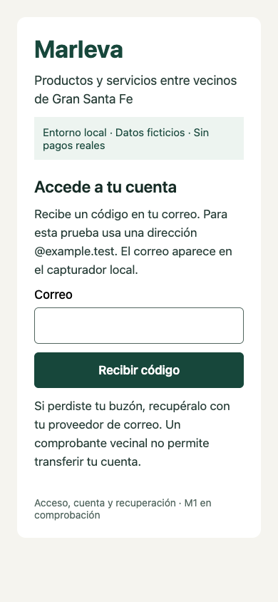
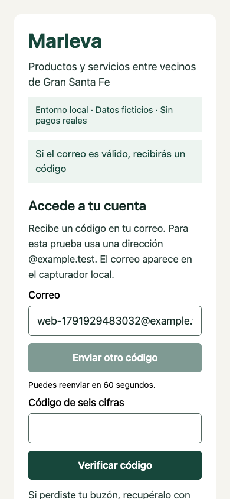
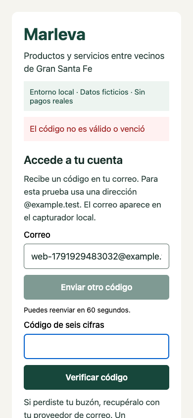
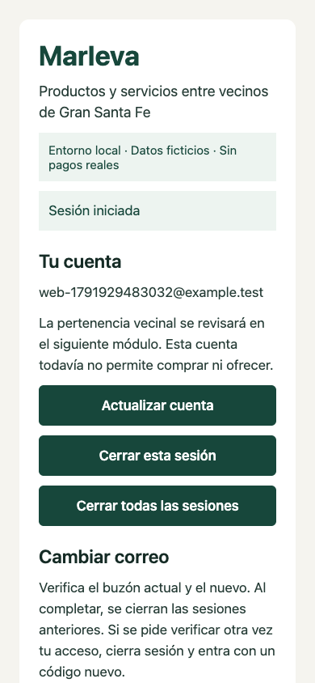
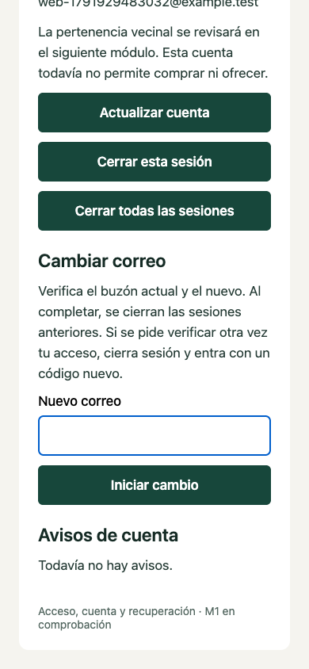
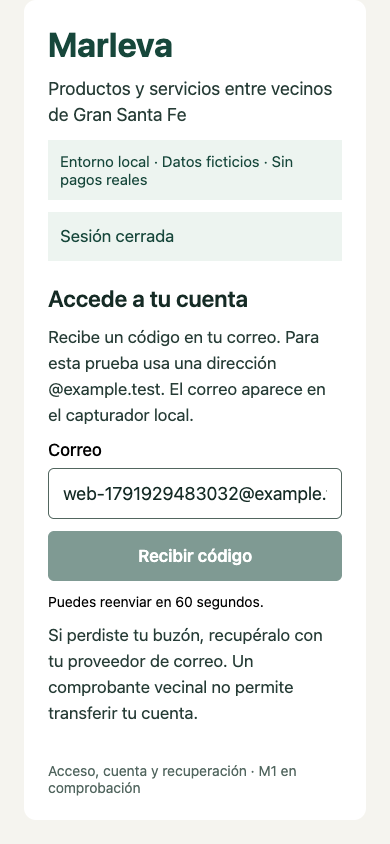

# M1: revisar acceso, cuenta y avisos

Fecha:13-10-2026 America/Merida. Entrega parcial, MAR-CHAT-005. Las capturas son de la aplicación real en Chrome, con datos ficticios; no son una maqueta ni una aprobación del diseño. No acreditan Android/iOS, lectores de pantalla o M1 terminada.

## Abrir la aplicación

En este Mac, abrir https://localhost:8443. Correo de prueba: una dirección nueva terminada en @example.test. Los mensajes llegan únicamente al capturador local en http://127.0.0.1:54324. Nunca escribir datos o dinero reales. Si la página no responde, seguir el arranque del [README](../../../README.md); no borrar la base ni desactivar la validación del certificado.

## 1. Entrar por correo

1. Escribir un correo ficticio nuevo.
2. Pulsar Recibir código.
3. Abrir el capturador y localizar ese correo. No publicar ni copiar su código en documentación.
4. Volver a Marleva, escribir el código y pulsar Verificar código.
5. Debe aparecer Tu cuenta. Tener cuenta todavía no permite comprar u ofrecer.

Caso:UC001/UC002; secuencias001/002; API001/002. Recorrido Chrome probado. Espera de reenvío60s; código10min; cinco fallos/pausa15min. No se acorta la espera para la revisión.

## 2. Código incorrecto y recuperación del paso

Un código incorrecto debe mostrar el error y conservar el correo/paso. Corregirlo con el código vigente; si venció o se consumió, pedir otro cuando termine la espera. La captura se tomó después de limpiar el valor incorrecto; no muestra un código válido.

Caso:UC002. Error y continuación comprobados en Chrome; fallos/consumo/concurrencia también en pruebas API. No se han comprobado todas las combinaciones web/nativas.

## 3. Consultar cuenta y avisos

Usar Actualizar cuenta. Verificar correo y acciones propias. Avisos de cuenta muestra los avisos disponibles. La API ya permite páginas de24/máximo50 con cursor y conserva orden exacto; la interfaz existente todavía muestra la primera página, sin botón de siguiente. Ese cambio visual está pendiente de revisión.

Casos:UC003/UC008; API003/009. API:73avisos con empates/microsegundos, otra cuenta denegada, inserción y frontera borrada comprobadas. Correo caído no pierde la tarea ni repite negocio; SMTP puede repetir una entrega tras resultado incierto.

## 4. Cambiar correo

1. Escribir otra dirección ficticia en Nuevo correo.
2. Pulsar Iniciar cambio.
3. En el capturador, revisar los mensajes dirigidos al correo actual y al nuevo.
4. Confirmar cada buzón con su código; la primera confirmación conserva el correo anterior.
5. Al completar ambos, la cuenta conserva su ID y cierra las sesiones anteriores. Entrar con el correo nuevo.

Casos:UC005/UC006; API007/008. Ambos buzones/ID/revocación probados en API; esta captura muestra la sección disponible, no acredita el recorrido completo de cambio por UI. Si pide verificar de nuevo el acceso, cerrar sesión y entrar con otro código antes de iniciar el cambio.

## 5. Salir

Cerrar esta sesión debe devolver al acceso. Cerrar todas las sesiones requiere autenticación reciente y debe invalidar las otras sesiones de la aplicación. Volver al historial del navegador no debe recuperar una sesión revocada.

Caso:UC004. Salida actual probada en Chrome; actual/total, cookie segura y CSRF en API. Recorrido físico en dos dispositivos pendiente.

## 6. Segundo factor del operador ficticio

Solo las cuentas operadoras ficticias preparadas por el entorno muestran esa sección. Verificar correo reciente, preparar TOTP con un autenticador local y verificar el factor. No guardar capturas del secreto/QR ni compartirlo. El registro normal no concede el rol. Rol/AAL y revocación comprobados por API; instructivo con capturas seguras de ese flujo y recuperación administrativa todavía pendiente.

## 7. Pérdida del buzón y sesión vencida

Recuperar el buzón con su proveedor. Un comprobante vecinal no transfiere la cuenta. Si la sesión venció, volver a entrar y consultar el estado antes de repetir una acción. Retomar destinos internos completos, recuperación MFA y restauración todavía requieren implementación/pruebas. Google/Supabase permanece pendiente; no es una función de esta entrega.

## 8. Archivos privados B09

No hay formulario de documentos M2. B09 trabaja con texto ficticio privado. Revisión de su contrato en [YAML](../../apis/M1/openapi-objetivo-archivos.yaml) y [especificación](../../apis/M1/CONTRATO_B09_ARCHIVOS_PRIVADOS.md); Ya hay tres operaciones backend: emitir permiso temporal, leer y pedir borrado. Se probaron dos cuentas, otra sesión, caducidad/reemisión, cuota, contenido alterado, borrado idempotente, caída/reinicio de Storage y trabajadores concurrentes. Ver [acta B09](../../../tests/results/files-increment.json). No existe pantalla de archivos y este ensayo no acredita expedientes M2 ni restauración B12. Puede revisarse el contrato en un IDE; el Swagger local muestra las operaciones y no ejecuta solicitudes.

## Qué revisa cada parte

| Parte | Función | Cómo localizarla |
|---|---|---|
| Frontend | Presenta correo/código/cuenta, errores y acciones | apps/client/app/index.tsx; adaptador src/api.ts; pruebas tests/integration/frontend/M1 |
| Backend | Autoriza cuenta/sesión, guarda transiciones, lista avisos y entrega correo durable | apps/api/src; casos/puertos/repositorios de modules/m1; OpenAPI/Swagger en docs/apis/M1 |
| Datos | Conserva registros privados e historial de migraciones | Prisma en apps/api/prisma; DBML/DDL en docs/modelado-datos |
| Evidencia | Resultado esperado, obtenido y límites | tests/results/notices-increment.json y files-increment.json; matriz docs/proceso/MATRIZ_CASOS_M1.md |

Para reportar un fallo: indicar flujo, paso, qué se hizo, qué se esperaba y qué apareció. Añadir captura sin códigos, tokens ni datos reales. UC/SEQ/API permite rastrear el cambio y su prueba.

## Estado de la revisión

Usuario confirmó que revisará este instructivo y dará observaciones. Revisión/aceptación siguen pendientes; no hay aceptación por silencio. M1 no se declara terminada hasta cerrar casos, integración, accesibilidad, plataformas y recuperación. El [estado01](../../../../../entregables/fuentes_finales/01_ESTADO_Y_DECISIONES_MARLEVA.md) conserva continuidad y porcentajes cuando exista base comprobada.

Compilación Android en005 comprobada: APK debug ARM64 en apps/client/android/app/build/outputs/apk/debug/app-debug.apk, ignorado en Git; acta tests/results/android-build.json. Requiere Metro. Recorrido en emulador/dispositivo e iOS aún pendientes; las capturas de este instructivo siguen siendo Chrome.
